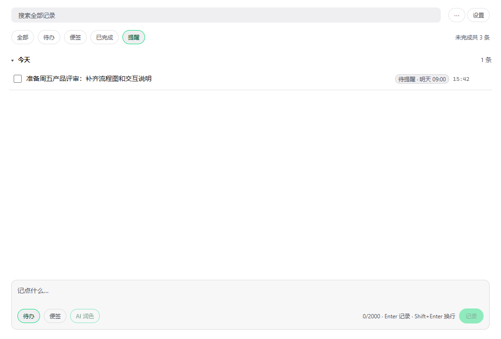
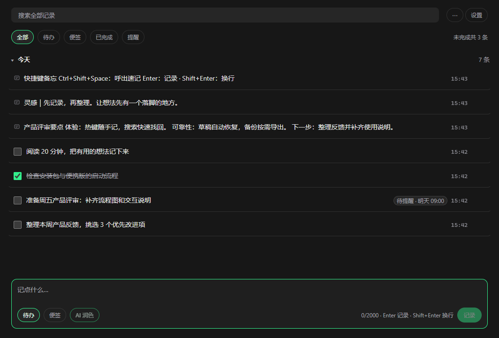
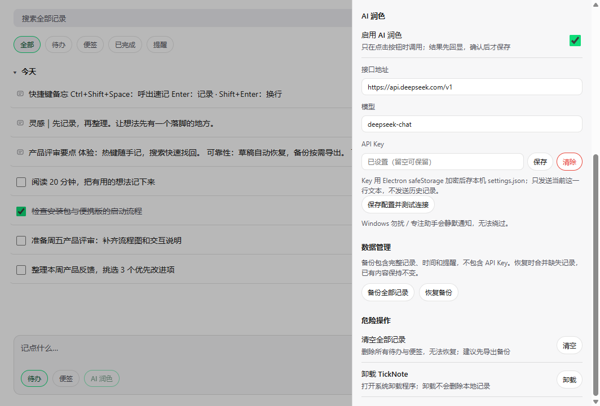

> English | [中文](README.zh-CN.md)

# TickNote

**Local-first quick notes and todos for Windows — with optional AI polish and MCP integration.**

TickNote (Chinese name 「待办便签」) is a tray-resident scratchpad. Press `Ctrl+Shift+Space`, type one line, hit `Enter`, and the popup disappears. Everything is stored in a single SQLite file on your machine, listed by creation date, and any MCP-capable AI client can read and write the same data.

## Screenshots

Captured from **TickNote 0.1.1 running on Windows** on October 30, 2026, using seven example records. The app UI is in Chinese.

The main window combines todos, notes, completed items and reminders in creation-time order.


Use the global hotkey to capture a thought, with multiline input and a todo / note switch.


| Search with highlighted hits                                     | Multiline notes and editing                                          |
| ---------------------------------------------------------------- | -------------------------------------------------------------------- |
|  |  |

| Reminder filter                                                   | Dark theme                                                  |
| ----------------------------------------------------------------- | ----------------------------------------------------------- |
|  |  |

| Markdown export scope                                                      | JSON backup and restore                                                     |
| -------------------------------------------------------------------------- | --------------------------------------------------------------------------- |
|  |  |

<details>
<summary>View general settings and MCP integration</summary>


</details>

See the [0.1.1 validation guide (Chinese)](docs/VALIDATION-0.1.1.md) and [screenshot notes](docs/screenshots/README.md) for capture details.

## Features

**Capture (global hotkey)**

- `Ctrl+Shift+Space` summons a frameless popup on the display under the mouse cursor; press it again to hide.
- `Enter` saves, `Shift+Enter` inserts a newline, `Esc` dismisses without saving.
- Drag the popup by its 18px top bar, close it with the `×` button (hides, does not quit). The position is remembered for the current session and clamped back into the work area.
- Hides automatically on blur (configurable), preserving the draft for next time. Esc explicitly discards it. Main-window and popup drafts survive restarts.
- The last keypress of the hotkey is discarded if it leaks into the freshly focused input.

**Main window**

- Records grouped by creation date (Today / Yesterday / earlier), with collapsible groups.
- Full-text search over SQLite FTS5 with the `trigram` tokenizer (works for Chinese); queries shorter than 3 characters fall back to `LIKE`.
- Filter chips: All / Todos / Notes / Done / Reminders, plus a `⋯` menu and settings. The unfinished count includes all open todos.
- Cards are truncated to 2 lines; click any row (or press `↑`/`↓` then `Enter`) to slide out the details drawer. There you can edit the text (saved on blur), switch note ↔ todo, set or clear a reminder, complete/restore, copy, and delete (undo within 5 seconds).
- `Ctrl+N` focuses the composer; `Enter` saves and keeps the focus, `Shift+Enter` inserts a newline.
- Export Markdown to a folder you choose: all records, the current filter, or today only. Each export gets a separate subfolder, preserving earlier exports. Tray export uses the last or default directory.
- Reminders are scanned every 30 seconds and shown as Windows toast notifications; clicking one opens the matching record. Reminders missed while the app was closed are merged into a single notification at startup.

**Desktop integration**

- Tray-resident: closing the main window hides it; only the tray menu can quit.
- Launch at login (`--autostart`, tray only, no window) — enabled by default for installed builds, toggleable in settings.
- Follow-system / light / dark theme, persisted in `settings.json`.
- Settings: record a new hotkey, hide-on-blur, MCP delete switch, AI configuration and connection test, JSON backup / restore, clear all records, uninstall.
- JSON backups preserve records, timestamps and reminders. Restore inserts missing IDs without overwriting existing records; settings, API keys and unsubmitted drafts are excluded.

**AI polish (optional, off by default)**

- A button appears in the capture popup and the composer only after you enable it.
- Only the current input (possibly multiple lines, up to 2000 characters) is sent, to the OpenAI-compatible endpoint and model you configure. The result is echoed back into the input with an undo option; nothing is saved until you press `Enter` / click save.
- If the request fails or times out (3s), your original text is kept.

## MCP

TickNote ships a built-in stdio MCP server that talks to the same SQLite database, so an AI client can use TickNote even when the app is not running. It exposes five tools by default, or six when deletion is enabled:

| Tool            | Purpose                                                                 |
| --------------- | ----------------------------------------------------------------------- |
| `create_item`   | Create a note or todo (records are tagged `source=ai`)                  |
| `list_items`    | List by creation-time range, status and kind                            |
| `search_items`  | Full-text search (FTS5 trigram)                                         |
| `update_item`   | Partially update content / kind / status / reminder                     |
| `complete_item` | Mark a record as done                                                   |
| `delete_item`   | Hard delete; **not registered by default**, must be enabled in settings |

See [docs/MCP.md](docs/MCP.md) for client configuration (Claude Desktop, Cursor), the database path resolution rules, and risk notes.

## Install

Download the latest build from the [Releases](https://github.com/TickNote/ticknote/releases) page. Two options:

1. **Installer** — `TickNote-x.y.z-Setup.exe` (NSIS, per-user install, no admin rights required, desktop + Start Menu shortcuts).
   The build is **not code-signed**, so Windows SmartScreen will show "Unknown publisher" / "Windows protected your PC". That is expected: choose _More info_ → _Run anyway_.
2. **Portable** — `TickNote-x.y.z-portable.zip`. Unzip and run `TickNote.exe`. Records still default to `%APPDATA%\TickNote`. If the zip came from the internet, unblock it first:
   ```powershell
   Unblock-File .\TickNote-x.y.z-portable.zip
   ```

Each release also ships `SHA256SUMS.txt` so you can verify the downloads.

Data lives in `%APPDATA%\TickNote`:

| Item            | Path                                                    |
| --------------- | ------------------------------------------------------- |
| Database        | `%APPDATA%\TickNote\ticknote.db` (plus `-wal` / `-shm`) |
| Settings        | `%APPDATA%\TickNote\settings.json`                      |
| Markdown export | `%APPDATA%\TickNote\export\`                            |

Uninstalling does **not** delete your records (`deleteAppDataOnUninstall: false` in the build config). Delete the folder above manually if you really want to start over.

## Requirements

- **Windows 10 / 11 x64.**
- For development: **Node.js >= 22** (`.nvmrc` pins 22). The database is the built-in `node:sqlite`, so there is no native module to compile.

## Development

```powershell
git clone https://github.com/TickNote/ticknote.git
cd ticknote
npm install
npm run dev
```

| Command                           | What it does                                                          |
| --------------------------------- | --------------------------------------------------------------------- |
| `npm run dev`                     | electron-vite dev server with HMR                                     |
| `npm run build`                   | Build main / preload / renderer into `out/`                           |
| `npm run build:mcp`               | Bundle the MCP server into `resources/mcp/server.js` (gitignored)     |
| `npm run build:all`               | `build` + `build:mcp`                                                 |
| `npm start`                       | Run the already-built app (`electron .`)                              |
| `npm run typecheck`               | `tsc --noEmit`                                                        |
| `npm test`                        | `vitest run` + MCP end-to-end test (`scripts/test-mcp.ts`)            |
| `npm run test:mcp`                | MCP end-to-end test only (run `build:mcp` first)                      |
| `npm run dist`                    | Build everything and package with electron-builder into `release/`    |
| `npm run pack:portable`           | Zip `release/win-unpacked` into `release/TickNote-x.y.z-portable.zip` |
| `npm run lint` / `npm run format` | oxlint / Prettier                                                     |

More detail in [CONTRIBUTING.md](CONTRIBUTING.md).

## Privacy

TickNote is local-first:

- No telemetry, no analytics, no account, no crash reporting.
- No background network access. Outbound requests occur only when you click AI polish or its connection test: polish sends the current input; the test sends a fixed sentence.
- AI polish sends just the current input text to the endpoint and model you configured (an OpenAI-compatible `/chat/completions` API). The API key is encrypted with Electron `safeStorage` and stored locally in `settings.json`.
- MCP is a local `stdio` process — no network listener, no cloud relay.

Full details: [docs/PRIVACY.md](docs/PRIVACY.md).

## Status & limitations

- **Windows only.** Tray behavior, toast notifications and the NSIS installer are all Windows-specific.
- **Unsigned builds.** SmartScreen warnings are expected until code signing is set up.
- **AI needs your own key.** AI polish is off by default and requires an OpenAI-compatible endpoint plus an API key; the app never bundles or proxies credentials.
- **No recycle bin, no sync, no rich text.** GUI single-item deletion offers 5-second undo, without a persistent recycle bin. MCP deletion and clear-all have no such undo. There is no cloud account, attachment or formatting support.
- **MCP delete is off by default.** It must be enabled in settings, and the AI client must be restarted afterwards.
- **Cross-process refresh has a short delay.** MCP changes refresh lists, search results, and statistics automatically within about two seconds. Returning focus to the window also refreshes data.
- **The UI is Chinese.** Product name is TickNote, but window titles, menus and labels are in Chinese (「待办便签」).

## Documentation

Both language versions are listed side by side:

- Architecture: [中文](docs/ARCHITECTURE.md) · [English](docs/ARCHITECTURE.en.md) — process layout, IPC contract, database, security model, extension guide
- MCP: [中文](docs/MCP.md) · [English](docs/MCP.en.md) — MCP server setup and tools
- Privacy: [中文](docs/PRIVACY.md) · [English](docs/PRIVACY.en.md) — data handling
- Contributing: [中文](CONTRIBUTING.md) · [English](CONTRIBUTING.en.md)
- Security policy: [中文](SECURITY.md) · [English](SECURITY.en.md)
- Code of conduct: [中文](CODE_OF_CONDUCT.md) · [English](CODE_OF_CONDUCT.en.md)
- [DESIGN.md](DESIGN.md) — full product/design spec (Chinese)
- [CHANGELOG.md](CHANGELOG.md) — release history

## License

MIT © TickNote Contributors. See [LICENSE](LICENSE).
