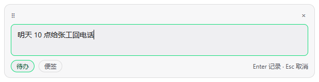
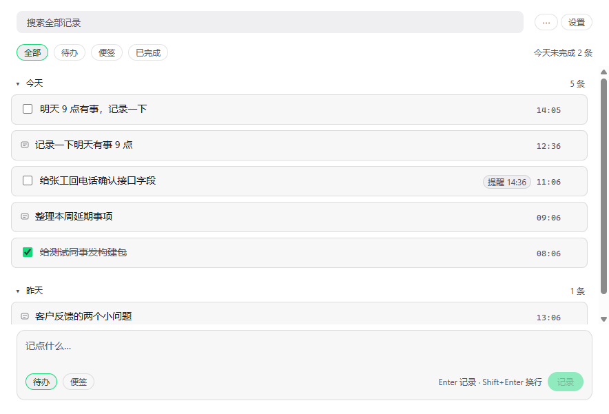
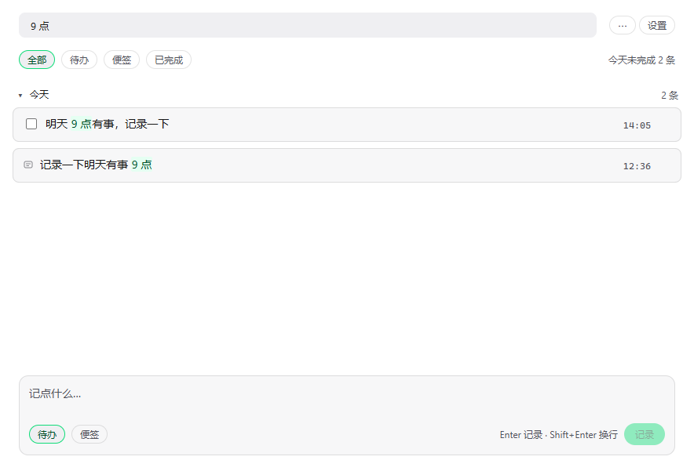
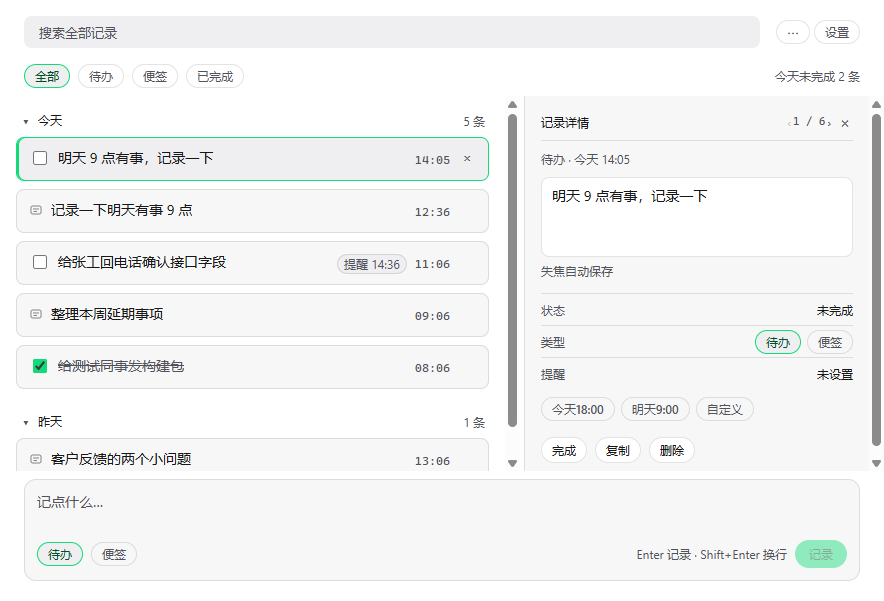
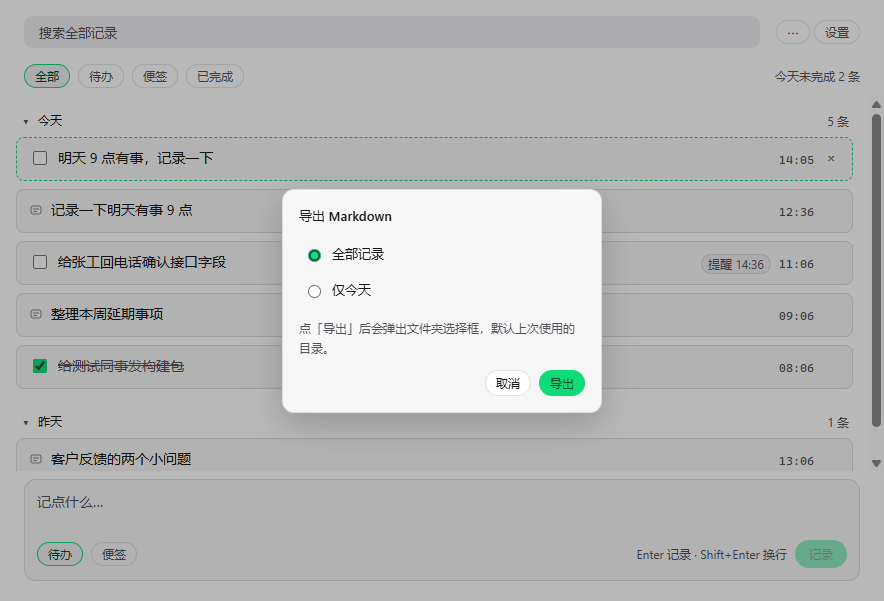
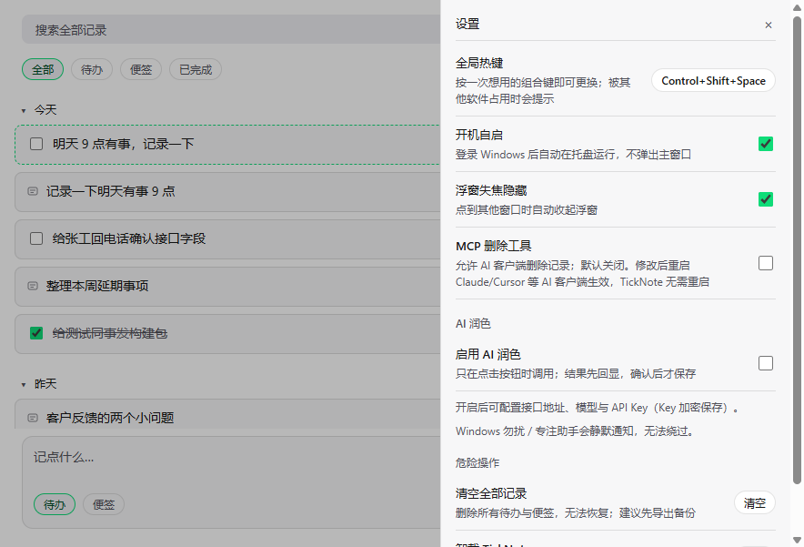

> [English](README.md) | 中文

# TickNote（待办便签）

**面向 Windows 的本地优先速记与待办工具，可选 AI 润色与 MCP 集成。**

按 `Ctrl+Shift+Space` 弹出浮窗，写一行，回车，窗口消失。所有记录都存在本机的一个 SQLite 文件里，按创建日期排列；任何支持 MCP 的 AI 客户端都能读写同一份数据。

## 截图





| 搜索高亮                             | 详情抽屉                             |
| ------------------------------------ | ------------------------------------ |
|  |  |

| 导出范围选择                         | 设置面板                               |
| ------------------------------------ | -------------------------------------- |
|  |  |

## 功能

**捕获（全局热键）**

- `Ctrl+Shift+Space` 在鼠标所在显示器唤起无边框浮窗；再按一次收起。
- `Enter` 保存，`Shift+Enter` 换行，`Esc` 取消不保存。
- 浮窗顶部有 18px 拖动条，可拖到任意位置；右上角 `×` 只隐藏浮窗，不退出应用。位置在本次运行内记住，越界会被夹回工作区。
- 失焦自动隐藏（可在设置里关闭）。
- 热键末尾的按键若漏进刚聚焦的输入框，会被丢弃。

**主窗**

- 按创建日期分组（今天 / 昨天 / 更早），分组可折叠。
- 基于 SQLite FTS5 + `trigram` 分词的全文本搜索（中文可用）；少于 3 个字符时回退到 `LIKE`。
- 筛选：全部 / 待办 / 便签 / 已完成，另有 `⋯` 菜单与设置面板。
- 列表卡片最多 2 行；点击整行（或 `↑` / `↓` 选中后按 `Enter`）从右侧滑出详情抽屉。抽屉内可编辑正文（失焦保存）、切换待办 / 便签、设置或清除提醒、完成 / 取消完成、复制、删除（二次确认）。
- `Ctrl+N` 聚焦底部输入框；`Enter` 记录并保持焦点，`Shift+Enter` 换行。
- 导出 Markdown 到 `%APPDATA%\TickNote\export\notes-YYYY-MM-DD.md`，范围可选：全部记录 / 当前筛选 / 仅今天；托盘菜单也可导出。
- 提醒每 30 秒扫描一次，到点弹 Windows 通知，点击跳转到对应记录；应用未运行期间错过的提醒，启动时合并成一条提示。

**桌面集成**

- 托盘常驻：关闭主窗只是隐藏，只有托盘菜单「退出」才真正退出。
- 开机自启（`--autostart`，只进托盘不弹窗）——安装版默认开启，可在设置关闭。
- 外观跟随系统 / 浅色 / 深色，写入 `settings.json`，重启后保持。
- 设置面板：录制式改全局热键、浮窗失焦隐藏、MCP 删除开关、AI 润色配置、清空全部记录、卸载。

**AI 润色（可选，默认关闭）**

- 在设置里开启后，浮窗与主窗输入区才会出现「AI 润色」按钮。
- 只发送当前这一行文本到你配置的 OpenAI 兼容端点与模型。结果回显到输入框，可撤销；不按 `Enter` / 不点记录就不会落库。
- 请求失败或超时（3 秒）时保留原文，绝不丢输入。

## MCP

内置 stdio MCP server，与 App 共用同一个 SQLite 数据库，因此 **App 不启动时 AI 也能读写**。共 6 个工具：

| 工具            | 作用                                   |
| --------------- | -------------------------------------- |
| `create_item`   | 新建便签 / 待办（来源标记为 `ai`）     |
| `list_items`    | 按创建时间范围、状态、类型列出         |
| `search_items`  | 全文搜索（FTS5 trigram）               |
| `update_item`   | 局部更新内容 / 类型 / 状态 / 提醒      |
| `complete_item` | 标记完成                               |
| `delete_item`   | 硬删除；**默认不注册**，需在设置里开启 |

客户端配置（Claude Desktop、Cursor）、数据库路径解析规则与风险说明见 [docs/MCP.md](docs/MCP.md)。

## 安装

从 [Releases](https://github.com/TickNote/ticknote/releases) 下载最新构建，两种方式：

1. **安装包** —— `TickNote-x.y.z-Setup.exe`（NSIS，按用户安装，无需管理员权限，创建桌面与开始菜单快捷方式）。
   安装包 **未签名**，Windows SmartScreen 会提示「未知发布者 / Windows 已保护你的电脑」，属正常现象：点「更多信息」→「仍要运行」即可。
2. **便携版** —— `TickNote-x.y.z-portable.zip`，解压即用，不写注册表。若压缩包来自网络，建议先解除锁定：
   ```powershell
   Unblock-File .\TickNote-x.y.z-portable.zip
   ```

每个 Release 还附带 `SHA256SUMS.txt`，可用于校验下载文件。

数据位置在 `%APPDATA%\TickNote`：

| 内容          | 路径                                                   |
| ------------- | ------------------------------------------------------ |
| 数据库        | `%APPDATA%\TickNote\ticknote.db`（含 `-wal` / `-shm`） |
| 设置          | `%APPDATA%\TickNote\settings.json`                     |
| Markdown 导出 | `%APPDATA%\TickNote\export\`                           |

卸载 **不会删除记录**（构建配置里 `deleteAppDataOnUninstall: false`）。想彻底清空，请手动删除上面的目录，或在设置面板「清空全部记录」。

## 环境要求

- **Windows 10 / 11 x64。**
- 开发需要 **Node.js >= 22**（`.nvmrc` 固定为 22）。数据库用 Node 内置的 `node:sqlite`，没有原生模块要编译。

## 开发

```powershell
git clone https://github.com/TickNote/ticknote.git
cd ticknote
npm install
npm run dev
```

| 命令                              | 作用                                                                 |
| --------------------------------- | -------------------------------------------------------------------- |
| `npm run dev`                     | electron-vite 开发服务（热更新）                                     |
| `npm run build`                   | 构建 main / preload / renderer 到 `out/`                             |
| `npm run build:mcp`               | 用 esbuild 打包 MCP server 到 `resources/mcp/server.js`（不入库）    |
| `npm run build:all`               | `build` + `build:mcp`                                                |
| `npm start`                       | 运行已构建的应用（`electron .`）                                     |
| `npm run typecheck`               | `tsc --noEmit`                                                       |
| `npm test`                        | `vitest run` + MCP 端到端脚本（`scripts/test-mcp.ts`）               |
| `npm run test:mcp`                | 只跑 MCP 端到端测试（先 `build:mcp`）                                |
| `npm run dist`                    | 全量构建并用 electron-builder 打包到 `release/`                      |
| `npm run pack:portable`           | 把 `release/win-unpacked` 打成 `release/TickNote-x.y.z-portable.zip` |
| `npm run lint` / `npm run format` | oxlint / Prettier                                                    |

更多约定见 [CONTRIBUTING.md](CONTRIBUTING.md)。

## 隐私

本地优先：

- 不收集遥测、不做统计、无账号、无崩溃上报。
- 不做后台联网。**唯一**的出站请求是 AI 润色，且只在你开启并点击按钮时发生。
- AI 润色只发送当前这一行文本到你配置的端点与模型（OpenAI 兼容 `/chat/completions`）。API Key 用 Electron `safeStorage` 加密后存在本机 `settings.json`。
- MCP 是本地 `stdio` 进程，没有网络监听，也没有云端中转。

完整说明见 [docs/PRIVACY.md](docs/PRIVACY.md)。

## 状态与限制

- **仅支持 Windows。** 托盘、系统通知与 NSIS 安装包都是 Windows 专属。
- **未签名。** 在配置代码签名之前，SmartScreen 提示不可避免。
- **AI 需自备 Key。** 默认关闭，需要你自己的 OpenAI 兼容端点与 Key，应用不内置也不代理凭据。
- **无回收站、无同步、无富文本。** 删除即永久删除，不支持云账号、附件与格式。
- **MCP 删除默认关闭。** 需在设置里开启，并重启 AI 客户端才生效。
- **跨进程刷新不是实时的。** MCP 客户端在应用运行期间写入的记录不会主动推送到主窗，切换筛选或重开主窗才能看到。
- **界面为中文。** 程序与安装包名为 TickNote，窗口标题、菜单和文案均为中文（「待办便签」）。

## 文档

中英文版本并列列出：

- 架构说明：[中文](docs/ARCHITECTURE.md) · [English](docs/ARCHITECTURE.en.md) —— 三层结构、IPC 契约、数据库、安全模型、扩展指南
- MCP：[中文](docs/MCP.md) · [English](docs/MCP.en.md) —— MCP 配置与工具说明
- 隐私：[中文](docs/PRIVACY.md) · [English](docs/PRIVACY.en.md) —— 数据处理说明
- 贡献指南：[中文](CONTRIBUTING.md) · [English](CONTRIBUTING.en.md)
- 安全策略：[中文](SECURITY.md) · [English](SECURITY.en.md)
- 行为准则：[中文](CODE_OF_CONDUCT.md) · [English](CODE_OF_CONDUCT.en.md)
- [DESIGN.md](DESIGN.md) —— 完整产品与设计文档
- [CHANGELOG.md](CHANGELOG.md) —— 版本变更记录

## 许可证

MIT © TickNote Contributors，详见 [LICENSE](LICENSE)。
