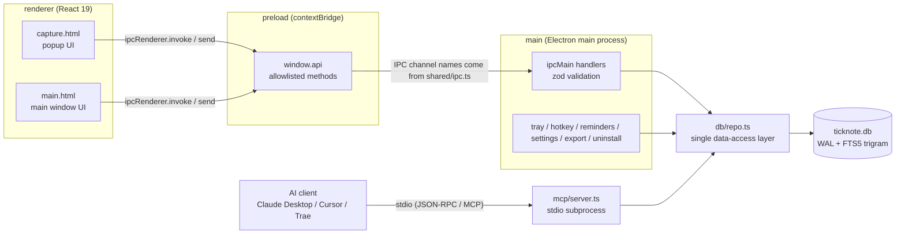

> [中文](ARCHITECTURE.md) | English

# TickNote architecture (0.1.1)

> An implementation-level description for contributors. The full product/interaction spec lives in [DESIGN.md](../DESIGN.md) at the repository root; MCP client configuration is in [MCP.en.md](MCP.en.md).

TickNote is a single-machine app built with Electron + React 19 + SQLite. There is no server and no cloud sync. It is made of five small blocks that stay within their own boundaries:

| Layer        | Location               | Responsibility                                                                                                                           |
| ------------ | ---------------------- | ---------------------------------------------------------------------------------------------------------------------------------------- |
| **main**     | `src/main/`            | Electron main process: window, tray, global hotkey, reminder scheduling, settings read/write, export, uninstall, IPC handlers, DB access |
| **preload**  | `src/preload/index.ts` | `contextBridge` allowlist: only explicitly listed methods are exposed as `window.api`                                                    |
| **renderer** | `src/renderer/`        | React 19 UI, two entries: `main.html` (main window) and `capture.html` (popup)                                                           |
| **shared**   | `src/shared/`          | IPC channel names (`ipc.ts`) and cross-process DTOs / types (`types.ts`)                                                                 |
| **mcp**      | `src/mcp/server.ts`    | Standalone stdio MCP server, reuses `main/db/repo.ts`, talks directly to the same SQLite file                                            |

Key conventions:

1. `src/main/db/repo.ts` is the **only** module that writes SQL directly. Both main-process IPC and the MCP server call it; assembling SQL anywhere else is forbidden.
2. The renderer has no Node capabilities and can only reach the main process through `window.api`.
3. Every cross-process input is validated with zod on the main side; type definitions are centralized in `src/shared/types.ts`.

---

## 1. Overall structure



`main` and `mcp` are **two separate processes**. They never talk over IPC; they share the same data concurrently through SQLite WAL.

---

## 2. Directory layout

```
ticknote/
├─ src/
│  ├─ main/
│  │  ├─ index.ts              # entry: single instance, bootstrap, hotkey, reminder loop, export, uninstall
│  │  ├─ windows.ts            # main / popup window creation, positioning, showing, window hardening
│  │  ├─ tray.ts               # tray icon, context menu, tooltip
│  │  ├─ ipc.ts                # ipcMain handler registration and zod validation
│  │  ├─ settings.ts           # settings.json read/write, safeStorage encryption, defaults
│  │  ├─ db/
│  │  │  ├─ schema.ts          # DDL + SCHEMA_VERSION (compiled into the bundle, no runtime file reads)
│  │  │  └─ repo.ts            # Repo interface + implementation (node:sqlite), the only data-access layer
│  │  ├─ ai/parse.ts           # OpenAI-compatible /chat/completions polish (3-second timeout)
│  │  └─ export/markdown.ts    # export notes-YYYY-MM-DD.md grouped by creation date
│  ├─ preload/
│  │  └─ index.ts              # contextBridge.exposeInMainWorld('api', ...)
│  ├─ renderer/
│  │  ├─ main.html             # main window entry (includes CSP meta)
│  │  ├─ capture.html          # popup entry (includes CSP meta)
│  │  └─ src/
│  │     ├─ main.tsx           # main window state and interaction: list / search / keyboard / export
│  │     ├─ capture.tsx        # popup: input / kind switch / AI polish / auto height
│  │     ├─ api.ts             # renderer-side API wrapper; uses mocks when previewing in a browser
│  │     ├─ utils.ts           # date grouping, time formatting, hotkey → accelerator
│  │     ├─ hooks.ts           # Draft persistence / errors / dialog focus
│  │     ├─ styles.css         # styles shared by both windows
│  │     └─ components/        # TopBar / ListItem / Drawer / SettingsPanel / ExportDialog / Toast
│  ├─ shared/
│  │  ├─ ipc.ts                # IPC channel name constants
│  │  ├─ validation.ts         # Item / versioned backup validation
│  │  └─ types.ts              # Item / Settings / query and result DTOs
│  └─ mcp/
│     └─ server.ts             # stdio MCP server (standalone process entry)
├─ resources/
│  └─ mcp/server.js            # esbuild output (gitignored, produced by npm run build:mcp)
├─ tests/
│  ├─ repo.test.ts             # repository layer: paging / FTS / reminders / clear-all
│  ├─ export.test.ts           # Markdown export format
│  ├─ reliability.test.ts      # Paging ties / literal search / export / backup restore
│  ├─ settings.test.ts         # Encryption unavailable / write failure / recovery
│  └─ ai-parse.test.ts         # AI polish request format and fallback
├─ scripts/
│  ├─ test-mcp.ts              # MCP end-to-end test (stdio client → server.js)
│  ├─ test-db.ts               # repo-layer smoke script (can run standalone)
│  ├─ test-ai.ts               # AI polish parsing smoke test (local fake HTTP server)
│  └─ pack-portable.ps1        # zip release/win-unpacked into a portable archive
├─ build/
│  ├─ icon.png                 # 256px application icon
│  └─ installer.nsh            # NSIS customization: Start Menu “Uninstall TickNote” shortcut
├─ electron.vite.config.ts     # three-target build config (zod inlined into the main bundle)
├─ electron-builder.yml        # NSIS / extraResources / icon / output directory
├─ vitest.config.mts           # unit test config (tests/**/*.test.ts)
├─ .prettierrc / .prettierignore
├─ tsconfig.json / package.json / .nvmrc
└─ docs/                        # this directory: architecture, MCP, privacy
```

---

## 3. Main process (`src/main/`)

### 3.1 Startup and refresh

`index.ts` sets the app name/AUMID, data directory and single-instance lock; copies legacy data, loads settings, opens the repo, injects IPC dependencies, creates windows/tray and registers the hotkey. `--autostart` stays in the tray; development runs do not register login items. The main window is 900×640, minimum 720×520; closing hides it and tray Quit exits.

Missed reminders are scanned at startup, then every 30 seconds. Every 2 seconds `repo.dataVersion()` (`PRAGMA data_version`) detects writes from external connections such as MCP and broadcasts `items:changed`, refreshing counts too. A day change also triggers refresh. Quitting clears timers, hotkeys and the database. The renderer separately refreshes on window focus, including active search.

### 3.2 Windows, tray and reminders

- Popup: width 620, initial height 150; normally 242–298 after rendering. Main-process `capture:resize` clamps to 180–330. Opaque, frameless, always on top; drag position is remembered for this run and clamped to the display work area. Blur hiding is configurable; blur/×/hotkey preserve drafts, Esc explicitly discards.
- Tray counts all open todos and pending reminders, rather than today's open todos.
- Reminder scan: `remind_at <= now AND reminded_at IS NULL AND status='open'`. Mark before requesting the OS notification to avoid duplicates; the mark is not a delivery receipt. More than 3 are merged, as are missed startup reminders. Clicking selects the reminders filter and opens the item (the first item for a merged notification).

### 3.3 Settings, export and backup

- `settings.ts` validates allowed fields, flushes a temporary file then renames it, and retains a valid prior `.bak` for recovery. Failed writes throw before committing new in-memory settings.
- Keys use safeStorage. Saving a new key fails if encryption is unavailable. Legacy `plain:` values are encrypted on load or cleared if encryption is unavailable. The renderer receives only aiApiKeySet, never plaintext or ciphertext.
- Markdown scopes: `all | todo | note | done | reminders | today`. Main-window export picks a directory; tray export uses the last/default location. Each run creates a timestamped directory with a random suffix; previous exports survive. Reminders include the full local date and time.
- JSON backup uses system file dialogs and `{format:'ticknote-backup',version:1,exportedAt,items}`. It includes all Item fields, excluding settings, keys, unsubmitted drafts and internal ai_run_id. Restore validates the entire file (≤100 MB, ≤100000 items), then transactionally inserts missing IDs with exact timestamps. Existing IDs are never overwritten; other errors roll back. Daily automatic database backup is not implemented.
- Uninstall opens only a program next to process.execPath; portable builds explain how to delete the extracted folder. User data is retained.

### 3.4 IPC and AI

The complete channel table is in [DESIGN.md section 8](../DESIGN.md#8-ipc-契约); exact contracts are in shared/ipc.ts, shared/types.ts and preload/index.ts. Main validates input using zod. Most mutations broadcast changes; body edits and reminder changes are updated by the caller and refresh the tray.

0.1.1 adds backup:export/import (`{path,count} | null`, null on cancel) and ai:test (string). items:restore-deleted serves both list and drawer undo. Stats return `{todayOpenTodos,openTodos,pendingReminders}`; list supports reminders and a composite cursor.

ai:parse sends the current input (≤2000 characters) only on user action, with a 3-second timeout and null on failure. ai:test uses saved settings, the fixed message “请回复 OK”, and a 10-second timeout; it sends no records. HTTP/model/key errors are shown in the UI.

## 4. Preload (`src/preload/index.ts`)

contextBridge exposes only named API methods, never ipcRenderer or arbitrary channels. onCaptureShown/onItemsChanged/onItemsFocus/onOpenSettings return unsubscribe functions. `Api = typeof api` keeps renderer and browser mock contracts consistent. New methods include exportBackup/importBackup/testAi.

## 5. Renderer (`src/renderer/`)

- React 19, two HTML entries, shared styles and components. Missing preload in Electron fails immediately; a browser preview uses a mock.
- hooks.ts implements drafts, readable errors and dialog focus. Main/popup drafts, per-item edit drafts, collapsed groups and drawer width use localStorage. Unsubmitted drafts are not in record backups.
- Filters: all/todo/note/done/reminders. Reminders include open records with a reminder, including ones already marked reminded. Counts use all open todos. Data is grouped by creation date. Refresh reloads already-loaded pages and preserves the selected item separately; query generations reject stale results.
- Search is debounced 150ms and spans all records independently of the list filter. At most 50 results, with a refinement hint at the limit. Mutations, external writes and focus refresh it.
- Successful popup save clears the submitted draft and hides after about 450ms; reopening/editing cancels the old timer. A submission lock prevents duplicate Enter writes; composing IME Enter never submits; Shift+Enter inserts a newline.
- AI requests bind to draft/session versions; obsolete results are ignored. Undo restores both original text and kind.
- Drawer edits save on blur or Ctrl+Enter. Closing, navigation and kind/status changes wait for save; failure keeps the record open with retry. Header/footer remain visible while the body scrolls. At ≤780px the drawer overlays at about 420px; wider windows cap it at min(560px,50vw). Custom reminders require Apply and a future time. Copy uses the current draft and shows feedback.
- List and drawer deletion share 5-second undo; MCP deletion and clear-all do not. Settings/export dialogs contain focus, restore prior focus, and expose labels and keyboard actions.

## 6. Shared contracts (`src/shared/`)

- ipc.ts: channel constants.
- types.ts: Item, ItemCursor, ItemStats, Settings, BackupResult and other DTOs; CONTENT_LIMIT=2000.
- validation.ts: versioned backup and Item schemas, reused for deletion restore.

Contract changes must update main/preload/renderer/mock and pass typecheck.

## 7. Database

- repo.ts is the data access layer; schema.ts DDL is bundled. Built-in node:sqlite, WAL, busy_timeout=3000, synchronous=NORMAL. Schema version remains 1, compatible with 0.1.0. There is no additional application-level “retry once” policy.
- UTC milliseconds; order `(created_at DESC,id DESC)`, cursor `{createdAt,id}` works even when the boundary item is deleted. Numeric cursors are legacy compatibility. Completion/reminders do not move creation-date groups.
- FTS5 trigram: ≥3 characters use a quoted phrase with escaped quotes, preserving paths, URLs and parentheses. Short queries use escaped LIKE, including literal %/_/backslash. Triggers sync inserts/updates/deletes.
- Changing reminders clears reminded_at; completion sets completed_at and restoring clears it. MCP validates reminder time before a single create INSERT, so invalid times leave no partial record.
- Repo exposes create/list/listRange/search/get/setStatus/updateContent/update/remove/restore/clearAll/importItems/setReminder/dueReminders/markReminded/allForExport/stats/dataVersion/close and db. importItems transactionally merges missing IDs, skips only ID conflicts, and rolls back other errors.
- Schema changes append migrations and increment SCHEMA_VERSION; never alter shipped DDL.

## 8. Security model

Both windows use contextIsolation=true, nodeIntegration=false and sandbox=true. hardenWindow rejects new windows and navigation. CSP restricts local resources while retaining development ws and inline styles. Only explicit user actions initiate main-process AI requests. Database, drafts and exports are local plaintext; keys use OS encryption. IPC uses named methods and zod validation. MCP deletion is disabled by default and requires confirm=true. No cloud server, telemetry, auto-update or background networking.

## 9. MCP process model

An independent stdio process uses only the SDK and repo, without UI modules. esbuild produces resources/mcp/server.js, copied outside asar with extraResources. Clients launch TickNote.exe with ELECTRON_RUN_AS_NODE=1; no separate Node installation is needed and the app can be closed.

Path resolution prefers TICKNOTE_DB, then TICKNOTE_DATA (legacy QUICKNOTE_DATA accepted), then default AppData and legacy fallbacks. The delete switch comes from settings.json beside the database and requires restarting the client. Five tools by default, six with deletion; limit≤50, content≤2000. AI source and ai_run_id are written, but batch undo is not implemented. MCP does not deliver reminders; the running app does. See [MCP.en.md](MCP.en.md) for client setup.

## 10. Extension guide

### 10.1 Adding an IPC

Take “pin a record to the top” as an example (assume the channel `items:pin`):

1. **Types**: add the DTO / return type in `src/shared/types.ts` (if needed).
2. **Channel name**: add `itemsPin: 'items:pin'` to the `IPC` object in `src/shared/ipc.ts`.
3. **Data layer**: add the method to the `Repo` interface and implementation in `src/main/db/repo.ts`; SQL goes here only. Add assertions in `tests/repo.test.ts` where appropriate.
4. **Main handler**: register `ipcMain.handle(IPC.itemsPin, ...)` inside `setupIpc(deps)` in `src/main/ipc.ts` and validate the input with zod; after a write, call `deps.notifyItemsChanged()` (add the field to `IpcDependencies` when a new dependency is needed, and pass it from `index.ts`).
5. **preload**: add `pinItem` to the `api` object in `src/preload/index.ts`, returning `Promise<T>`; for event-style (main → renderer) APIs return an unsubscribe function instead.
6. **Renderer**: add a same-named method to the mock in `src/renderer/src/api.ts` (so browser preview keeps working), then call it from `main.tsx` / `capture.tsx` (or a component under `components/`).
7. **Docs**: update the channel table in this file and [DESIGN.md section 8](../DESIGN.md#8-ipc-契约).

Checkpoints: `npm run typecheck` must pass; new channel names must not be written as string literals; never expose `ipcRenderer` directly to the renderer.

### 10.2 Adding an MCP tool

1. Use `server.registerTool(name, { title, description, inputSchema, annotations }, handler)` with a zod `inputSchema`.
2. Only call `repo` methods, never write SQL; mark read operations with `annotations.readOnlyHint: true` and destructive ones with `destructiveHint: true`.
3. Return values go through `ok(serialize(item))` or `fail(message)`, keeping the serialized fields consistent with the existing tools (`id`, `content`, `kind`, `status`, `created_at`, `updated_at`, `remind_at`, `source`).
4. For deletes or other irreversible operations, do not register by default and gate them behind a switch in `settings.json` (see `delete_item`).
5. Update the tool table in [MCP.en.md](MCP.en.md) and add an end-to-end assertion in `scripts/test-mcp.ts`.

### 10.3 Changing the database schema

1. `src/main/db/schema.ts`: append the DDL and bump `SCHEMA_VERSION`.
2. `migrate()` in `src/main/db/repo.ts`: append a branch for old versions (never edit historical branches).
3. `tests/repo.test.ts`: cover that data survives the migration and that FTS still matches (vitest, configured in `vitest.config.mts`).
4. Record it in [CHANGELOG.md](../CHANGELOG.md).

---

## 11. Known limitations

- Windows only; no cloud sync, accounts, rich text or background networking.
- MCP refresh uses polling with about a 2-second delay, not real-time push.
- GUI single-item deletion has 5-second undo, no persistent recycle bin; MCP deletion and clear-all do not use this undo.
- Daily automatic database backup and AI batch undo are not implemented. Manual JSON record backup is available.
- OS settings affect notifications; a reminded mark is not proof of delivery. AI only polishes; it does not parse dates or automatically create records.
- Builds are unsigned. Installation, autostart, notification delivery, IME and multiple displays still need manual verification; see the [Chinese validation guide](VALIDATION-0.1.1.md).
