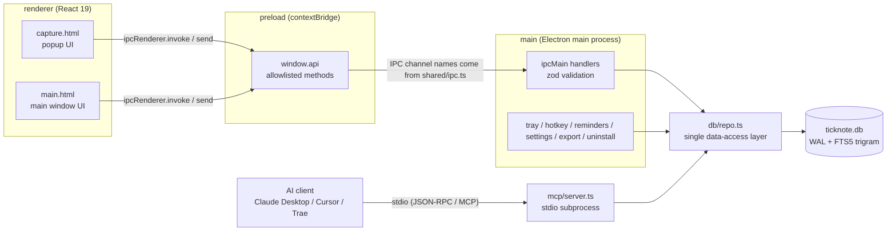
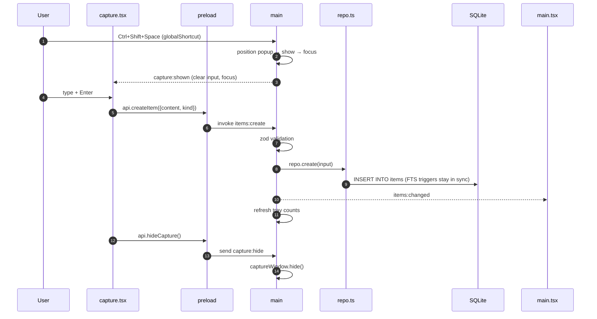

> [中文](ARCHITECTURE.md) | English

# TickNote architecture

> An implementation-level description for contributors. The full product/interaction spec lives in [DESIGN.md](../DESIGN.md) at the repository root; MCP client configuration is in [MCP.en.md](MCP.en.md).

TickNote is a single-machine app built with Electron + React 19 + SQLite. There is no server and no cloud sync. It is made of five small blocks that stay within their own boundaries:

| Layer        | Location               | Responsibility                                                                                                                           |
| ------------ | ---------------------- | ---------------------------------------------------------------------------------------------------------------------------------------- |
| **main**     | `src/main/`            | Electron main process: window, tray, global hotkey, reminder scheduling, settings read/write, export, uninstall, IPC handlers, DB access |
| **preload**  | `src/preload/index.ts` | `contextBridge` allowlist: only explicitly listed methods are exposed as `window.api`                                                    |
| **renderer** | `src/renderer/`        | React 19 UI, two entries: `main.html` (main window) and `capture.html` (popup)                                                           |
| **shared**   | `src/shared/`          | IPC channel names (`ipc.ts`) and cross-process DTOs / types (`types.ts`)                                                                 |
| **mcp**      | `src/mcp/server.ts`    | Standalone stdio MCP server, reuses `main/db/repo.ts`, talks directly to the same SQLite file                                            |

Key conventions:

1. `src/main/db/repo.ts` is the **only** module that writes SQL directly. Both main-process IPC and the MCP server call it; assembling SQL anywhere else is forbidden.
2. The renderer has no Node capabilities and can only reach the main process through `window.api`.
3. Every cross-process input is validated with zod on the main side; type definitions are centralized in `src/shared/types.ts`.

---

## 1. Overall structure



`main` and `mcp` are **two separate processes**. They never talk over IPC; they share the same data concurrently through SQLite WAL.

---

## 2. Directory layout

```
ticknote/
├─ src/
│  ├─ main/
│  │  ├─ index.ts              # entry: single instance, bootstrap, hotkey, reminder loop, export, uninstall
│  │  ├─ windows.ts            # main / popup window creation, positioning, showing, window hardening
│  │  ├─ tray.ts               # tray icon, context menu, tooltip
│  │  ├─ ipc.ts                # ipcMain handler registration and zod validation
│  │  ├─ settings.ts           # settings.json read/write, safeStorage encryption, defaults
│  │  ├─ db/
│  │  │  ├─ schema.ts          # DDL + SCHEMA_VERSION (compiled into the bundle, no runtime file reads)
│  │  │  └─ repo.ts            # Repo interface + implementation (node:sqlite), the only data-access layer
│  │  ├─ ai/parse.ts           # OpenAI-compatible /chat/completions polish (3-second timeout)
│  │  └─ export/markdown.ts    # export notes-YYYY-MM-DD.md grouped by creation date
│  ├─ preload/
│  │  └─ index.ts              # contextBridge.exposeInMainWorld('api', ...)
│  ├─ renderer/
│  │  ├─ main.html             # main window entry (includes CSP meta)
│  │  ├─ capture.html          # popup entry (includes CSP meta)
│  │  └─ src/
│  │     ├─ main.tsx           # main window state and interaction: list / search / keyboard / export
│  │     ├─ capture.tsx        # popup: input / kind switch / AI polish / auto height
│  │     ├─ api.ts             # renderer-side API wrapper; uses mocks when previewing in a browser
│  │     ├─ utils.ts           # date grouping, time formatting, hotkey → accelerator
│  │     ├─ styles.css         # styles shared by both windows
│  │     └─ components/        # TopBar / ListItem / Drawer / SettingsPanel / ExportDialog / Toast
│  ├─ shared/
│  │  ├─ ipc.ts                # IPC channel name constants
│  │  └─ types.ts              # Item / Settings / query and result DTOs
│  └─ mcp/
│     └─ server.ts             # stdio MCP server (standalone process entry)
├─ resources/
│  └─ mcp/server.js            # esbuild output (gitignored, produced by npm run build:mcp)
├─ tests/
│  ├─ repo.test.ts             # repository layer: paging / FTS / reminders / clear-all
│  ├─ export.test.ts           # Markdown export format
│  └─ ai-parse.test.ts         # AI polish request format and fallback
├─ scripts/
│  ├─ test-mcp.ts              # MCP end-to-end test (stdio client → server.js)
│  ├─ test-db.ts               # repo-layer smoke script (can run standalone)
│  ├─ test-ai.ts               # AI polish parsing smoke test (local fake HTTP server)
│  └─ pack-portable.ps1        # zip release/win-unpacked into a portable archive
├─ build/
│  ├─ icon.png                 # 256px application icon
│  └─ installer.nsh            # NSIS customization: Start Menu “Uninstall TickNote” shortcut
├─ electron.vite.config.ts     # three-target build config (zod inlined into the main bundle)
├─ electron-builder.yml        # NSIS / extraResources / icon / output directory
├─ vitest.config.mts           # unit test config (tests/**/*.test.ts)
├─ .prettierrc / .prettierignore
├─ tsconfig.json / package.json / .nvmrc
└─ docs/                        # this directory: architecture, MCP, privacy
```

---

## 3. Main process (`src/main/`)

### 3.1 Startup order

`src/main/index.ts` is the only entry point. The startup flow is:

1. `app.setName('TickNote')`, and override `userData` with `TICKNOTE_DATA` (the legacy name `QUICKNOTE_DATA` is also accepted) to make test isolation easy.
2. `app.setAppUserModelId('com.ticknote.app')` — this must match the AUMID used by the installer shortcuts, otherwise Windows toasts never show up.
3. `requestSingleInstanceLock()`: exit if the lock cannot be acquired; a second launch wakes the existing main window via the `second-instance` event.
4. `whenReady` → `bootstrap()`:
   - remove the default menu (`Menu.setApplicationMenu(null)`);
   - `migrateLegacyData(userData)`: run an idempotent migration once (same-directory `quicknote.db` → `ticknote.db`; legacy `%APPDATA%\QuickNote` directory → `%APPDATA%\TickNote`);
   - read `settings.json` and apply `nativeTheme.themeSource`;
   - for installed builds, write the launch-at-login entry on first start (guarded by `process.defaultApp !== true`, so dev mode never puts `electron.exe` into the startup entries);
   - `openRepo(userData/ticknote.db)` → `setupIpc({repo, ...})` (`ipc.ts`) → `createMainWindow()` / `createCaptureWindow()` (`windows.ts`) → `createTray()` (`tray.ts`) → `registerHotkey()`;
   - show the main window unless started with `--autostart`;
   - `scanReminders('missed')` first to catch up on missed reminders, then start the 30-second polling loop.
5. `before-quit` calls `markQuitting()` (`windows.ts`); `will-quit` clears timers, unregisters hotkeys and closes the database.
6. `window-all-closed` is intentionally left empty: the tray stays resident, so closing every window does not quit the app.

`index.ts` only orchestrates; windows, tray, IPC and settings each live in `windows.ts`, `tray.ts`, `ipc.ts` and `settings.ts`, communicating through explicitly passed dependencies or exported getters to avoid circular imports.

### 3.2 Windows

|          | Main window                                                                       | Popup                                                                                                                                                                            |
| -------- | --------------------------------------------------------------------------------- | -------------------------------------------------------------------------------------------------------------------------------------------------------------------------------- |
| Size     | 900×640, minimum 720×520, resizable                                               | 620 wide, default height 150, clamped by the main process to 120–240                                                                                                             |
| Look     | System title bar, background color follows the theme                              | `frame:false`, `alwaysOnTop`, `skipTaskbar`, `resizable:false`, with shadow                                                                                                      |
| Close    | Intercept `close` → `hide()`; show a one-time “still running in the tray” balloon | Renderer `×` / `Esc` / `hide()` on blur                                                                                                                                          |
| Position | System default                                                                    | First time: centered horizontally and slightly above on the display under the mouse cursor; after dragging it is remembered for the current run and clamped back into `workArea` |

The popup does not use `transparent:true` (on Windows, transparent frameless windows dislocate the IME candidate box for Chinese input). Dragging is implemented in the renderer with `-webkit-app-region: drag`; the close button is `no-drag`. When the popup content changes, the renderer calls `capture:resize` to report its height and the main process clamps it.

### 3.3 Tray, hotkey, reminders

- **Tray** (`src/main/tray.ts`): the icon is an embedded base64 PNG, so no runtime file is needed; left click shows the main window; the context menu contains “Open popup (shows the current hotkey) / Open main window / N unfinished today (disabled) / Export Markdown / Settings / Quit”. The tooltip shows today's unfinished count and the number of pending reminders.
- **Hotkey**: `Control+Shift+Space` by default, stored in `settings.json`. On startup and on rebinding, `globalShortcut.unregisterAll()` is called before re-registering; on failure only `hotkeyRegistered=false` is set and a log line is written — the settings panel then shows that in red, with the tray entry as a fallback.
- **Reminders**: every 30 seconds, `repo.dueReminders(now)` is called (`remind_at <= now AND reminded_at IS NULL AND status='open'`); `repo.markReminded()` writes to the database **first**, and the notification is shown **second**, so a restart never duplicates it; more than 3 items in the same round are merged into one notification; reminders missed while the app was not running are merged into “N reminders have expired”. Clicking the notification emits `items:focus`, and the main window focuses the record and opens the drawer.

### 3.4 Settings, export, uninstall

- `settings.json` lives in `userData/settings.json`; all reads and writes go through `src/main/settings.ts`. Reads merge in defaults and distinguish `aiApiKeySet` (the only boolean exposed externally) from the internal `aiApiKeyEncrypted`; `applySettingsPatch()` accepts an `onHotkeyChange` callback, injected by the IPC layer to re-register the hotkey.
- Export: `exportMarkdown(repo.allForExport(scope), userData/export)`, one file per creation date; scope is `all | todo | note | done | today`.
- Uninstall: only available in packaged builds. It looks for `Uninstall TickNote.exe` next to `process.execPath` (also accepting the legacy `Uninstall QuickNote.exe`) and opens it with `shell.openPath`; dev mode returns `reason:'dev'`, the portable build returns `reason:'portable'`, and the renderer then tells the user to just delete the unzipped directory.

### 3.5 IPC handlers

`setupIpc(deps)` registers everything in one place in `src/main/ipc.ts`; the dependencies (repo, `notifyItemsChanged`, `refreshTray`, `focusItem`, `exportNow`, `registerHotkey`, `uninstallApp`) are injected from `index.ts` through `IpcDependencies` to avoid circular imports. Every handler validates its input with zod item by item (string length, uuid format, enum values). After a successful write, `deps.notifyItemsChanged()` is called (refresh the tray + send `items:changed` to the main window), and the renderer re-fetches the list on receipt.

The full channel table is in [DESIGN.md section 8](../DESIGN.md#8-ipc-契约). Common channels:

| Channel                                                | Direction              | Input → output                                              |
| ------------------------------------------------------ | ---------------------- | ----------------------------------------------------------- |
| `items:create`                                         | renderer → main        | `{content, kind}` → `Item`                                  |
| `items:list`                                           | renderer → main        | `{filter, cursor?, limit?}` → `Item[]` (default 30, max 50) |
| `items:search`                                         | renderer → main        | `{q, limit?}` → `Item[]`                                    |
| `items:get`                                            | renderer → main        | `{id}` → `Item \| null`                                     |
| `items:update`                                         | renderer → main        | `{id, content}` → `Item \| null`                            |
| `items:set-kind`                                       | renderer → main        | `{id, kind}` → `Item \| null`                               |
| `items:complete` / `items:restore`                     | renderer → main        | `{id}` → `Item \| null`                                     |
| `items:set-reminder`                                   | renderer → main        | `{id, remindAt: number \| null}` → `Item \| null`           |
| `items:delete`                                         | renderer → main        | `{id}` → `boolean`                                          |
| `items:clear-all`                                      | renderer → main        | — → `number` (number of records deleted)                    |
| `items:stats`                                          | renderer → main        | — → `{todayOpenTodos, pendingReminders}`                    |
| `export:markdown`                                      | renderer → main        | `{scope}` → `{dir, files, count}`                           |
| `settings:get` / `settings:set`                        | renderer → main        | — / `SettingsPatch` → `Settings`                            |
| `autostart:get` / `autostart:set`                      | renderer → main        | — / `{enabled}` → `AutostartStatus`                         |
| `ai:parse`                                             | renderer → main        | `{content}` → `{content, kind} \| null`                     |
| `app:uninstall`                                        | renderer → main        | — → `UninstallResult`                                       |
| `capture:hide` / `capture:resize` / `window:open-main` | renderer → main (send) | —                                                           |
| `capture:shown`                                        | main → renderer        | Reset state and focus every time the popup is summoned      |
| `items:changed`                                        | main → renderer        | Refresh the main window after a create/update/delete        |
| `items:focus`                                          | main → renderer        | `{id}`, focus the record after clicking a notification      |
| `settings:open`                                        | main → renderer        | Tray “Settings” opens the settings panel                    |

### 3.6 Save flow



Note: **writes from the MCP process do not trigger `items:changed`** (there is no cross-process event). The main window refreshes only on its own IPC writes, filter switches, or remounts.

---

## 4. Preload (`src/preload/index.ts`)

It does exactly one thing: `contextBridge.exposeInMainWorld('api', api)`. What is exposed is an explicit allowlist of methods; the renderer never gets `ipcRenderer` and cannot name arbitrary channels.

- Method names map one-to-one to channels: `createItem`, `listItems`, `searchItems`, `getItem`, `completeItem`, `restoreItem`, `updateItem`, `setItemKind`, `deleteItem`, `clearAllItems`, `setReminder`, `exportMarkdown`, `stats`, `getSettings`, `updateSettings`, `setTheme`, `getAutostart`, `setAutostart`, `aiParse`, `uninstallApp`, `hideCapture`, `resizeCapture`, `openMain`.
- Event subscriptions return an unsubscribe function: `onCaptureShown`, `onItemsChanged`, `onItemsFocus`, `onOpenSettings`.
- `export type Api = typeof api`; the renderer derives its full typing from this (`src/renderer/src/api.ts` imports that type).

---

## 5. Renderer (`src/renderer/`)

- React 19 + `react-dom/client`, no router and no state library; window state uses `useState` / `useEffect`, and the only persistence is `localStorage` (collapsed groups, `ticknote.collapsedDays`).
- The two HTML entries load `src/main.tsx` and `src/capture.tsx` respectively and share `styles.css`; the build is declared by `renderer.build.rollupOptions.input` in `electron.vite.config.ts`.
- Views are split into components under `src/renderer/src/components/`: `TopBar` (search, `⋯` menu, settings entry), `ListItem` (row card), `Drawer` (detail drawer), `SettingsPanel` (settings panel), `ExportDialog` (export scope), `Toast` (lightweight toast); date grouping, time formatting and hotkey → accelerator conversion live in `src/renderer/src/utils.ts`.
- `src/renderer/src/api.ts` uses the preload API directly when `window.api` exists; when it does not (static preview in a browser) it falls back to built-in mock data. If `navigator.userAgent` says Electron but `window.api` is missing, it throws immediately to report that the preload was not loaded.
- Key main-window interactions:
  - Search input is debounced 150ms before calling `items:search`; clearing the search falls back to `items:list`.
  - Groups are computed from the creation date; group headers can be collapsed and that state is written to `localStorage`.
  - Keyboard: `Ctrl+N` focuses the input; `↑`/`↓` move the selection, `Enter` opens the drawer; `Esc` exits in the order “export dialog → settings → search → drawer”.
  - In the drawer you can edit the body (saved on blur), switch kind, set/clear a reminder, complete/restore, copy, delete with a two-step confirmation, and step to the previous/next record.
  - The export dialog picks the scope (all / current filter / today only).
- Key popup interactions: auto height (inner scrolling above 96px, with the total height reported to the main process), `Enter` submits (never while the IME is composing), `Esc` hides, `Shift+Enter` inserts a newline, leading spaces are dropped for 200ms (so a trailing hotkey keystroke never leaks in), the hint auto-hides after 900ms, and AI polish results can be echoed back and undone.

---

## 6. Shared contracts (`src/shared/`)

| File                  | Contents                                                                                                                                                                                                                           |
| --------------------- | ---------------------------------------------------------------------------------------------------------------------------------------------------------------------------------------------------------------------------------- |
| `src/shared/ipc.ts`   | The `IPC` constant object, the single source of truth for every channel name; both main and preload reference it, string literals are forbidden                                                                                    |
| `src/shared/types.ts` | `Item`, `ItemKind`, `ItemStatus`, `ItemSource`, `ListFilter`, `ListQuery`, `CreateItemInput`, `Settings`, `SettingsPatch`, `AutostartStatus`, `AiParseResult`, `ExportScope`, `ExportResult`, `UninstallResult`, `ThemePreference` |

When adding or changing IPC, update these two files first, then main and preload, and finally the renderer — that way TypeScript points out every place that needs to be kept in sync at compile time.

---

## 7. Database

### 7.1 Connection and location

- Uses the `node:sqlite` built into Electron / Node (`DatabaseSync`): no third-party dependency and no native module compilation.
- `openRepo()` does: `mkdirSync(dirname(dbPath))` → `new DatabaseSync(dbPath)` → `PRAGMA journal_mode = WAL` → `busy_timeout = 3000` → `synchronous = NORMAL` → migration.
- Main-process database path: `join(app.getPath('userData'), 'ticknote.db')`, i.e. `%APPDATA%\TickNote\ticknote.db` (`TICKNOTE_DATA` can change `userData`).
- The MCP process resolves the path itself, in this order: `TICKNOTE_DB` → `ticknote.db` under `TICKNOTE_DATA` (legacy `QUICKNOTE_DATA` accepted; the old `quicknote.db` is used if that is all there is) → `%APPDATA%\TickNote\ticknote.db` → the legacy file name in the same directory → `%APPDATA%\QuickNote\quicknote.db` → `~/.ticknote/ticknote.db`.
- The main process also runs an idempotent migration at startup, copying the legacy file name / directory to `%APPDATA%\TickNote\ticknote.db`.

### 7.2 Schema and indexes

The DDL in `src/main/db/schema.ts` (excerpt):

```sql
CREATE TABLE IF NOT EXISTS items (
  id           TEXT PRIMARY KEY,
  content      TEXT NOT NULL,
  kind         TEXT NOT NULL DEFAULT 'note' CHECK (kind IN ('note','todo')),
  status       TEXT NOT NULL DEFAULT 'open' CHECK (status IN ('open','done')),
  remind_at    INTEGER,
  reminded_at  INTEGER,
  created_at   INTEGER NOT NULL,
  updated_at   INTEGER NOT NULL,
  completed_at INTEGER,
  source       TEXT NOT NULL DEFAULT 'human' CHECK (source IN ('human','ai')),
  ai_run_id    TEXT
);

CREATE INDEX idx_items_created ON items(created_at);
CREATE INDEX idx_items_remind  ON items(remind_at) WHERE remind_at IS NOT NULL;
CREATE INDEX idx_items_status  ON items(status, created_at);
```

- All times are stored as UTC milliseconds and converted to the local time zone for display; grouping only uses `created_at`, `remind_at` never affects ordering.
- `ai_run_id` is written by the MCP `create_item` tool (one UUID per call) and identifies an AI write batch.

### 7.3 Full-text search

```sql
CREATE VIRTUAL TABLE items_fts USING fts5(
  content, content='items', content_rowid='rowid', tokenize='trigram'
);
```

Three `AFTER INSERT / AFTER DELETE / AFTER UPDATE` triggers keep the index in sync. The rules in `repo.search()`:

- Query string ≥ 3 characters: use `items_fts MATCH`; FTS syntax characters are stripped first and the rest is matched as a phrase, falling back to `LIKE` if that throws.
- Query string < 3 characters: plain `LIKE '%q%'` (the data set is small, so this is good enough).

`trigram` is what makes Chinese searchable — the default tokenizer is essentially useless for Chinese.

### 7.4 Migrations

`migrate()` reads `PRAGMA user_version`; when it is lower than `SCHEMA_VERSION` (currently `1`) it runs the DDL and writes the new version number inside one transaction. When upgrading the schema, **append** a migration branch and bump `SCHEMA_VERSION`; never edit DDL that has already shipped.

### 7.5 Repo interface

The `Repo` interface (`src/main/db/repo.ts`) contains: `create`, `list`, `listRange`, `search`, `get`, `setStatus`, `updateContent`, `update`, `remove`, `clearAll`, `setReminder`, `dueReminders`, `markReminded`, `allForExport`, `stats`, `close`.

A few easily-missed rules:

- `setReminder` / `update({remindAt})` must also set `reminded_at` to NULL, otherwise moving a reminder into the future would never fire again.
- `update({status:'done'})` writes `completed_at` at the same time; switching back to `open` clears it.
- Completing an item does not change its position: the list is always sorted by `created_at` descending, and completed items are distinguished by styling.
- `remove` is a hard delete (no recycle bin); `clearAll` returns the number of records deleted.

---

## 8. Security model

| Item                | Current state                                                                                                                                                 |
| ------------------- | ------------------------------------------------------------------------------------------------------------------------------------------------------------- |
| `contextIsolation`  | **On**: the renderer cannot reach Node / Electron internals                                                                                                   |
| `nodeIntegration`   | **Off**                                                                                                                                                       |
| `sandbox`           | **On** (both windows set `sandbox: true`; the preload only uses `contextBridge` + `ipcRenderer`, so it needs no Node)                                         |
| Renderer origin     | Only local files (`loadFile`) or `ELECTRON_RENDERER_URL` in dev; `hardenWindow()` denies new windows and blocks `will-navigate`                               |
| CSP                 | Both HTML entries carry a minimal CSP meta tag (see below)                                                                                                    |
| IPC input           | zod validation on the main side (length, uuid, enums); the renderer is never trusted                                                                          |
| Renderer capability | Only the `window.api` allowlist; channel names come from `shared/ipc.ts` and cannot be customized                                                             |
| AI key              | `safeStorage.encryptString()` then base64 into `aiApiKeyEncrypted` in `settings.json`; the renderer can only read the `aiApiKeySet` boolean                   |
| AI key fallback     | When `safeStorage.isEncryptionAvailable()` is false, write a `plain:<base64>` prefix (explicitly marked as unencrypted) instead of pretending it is encrypted |
| Database            | Opened only by the main / MCP processes; WAL + `busy_timeout` support concurrency                                                                             |
| Single instance     | `requestSingleInstanceLock`, so two instances never write the database at the same time                                                                       |
| Uninstall           | Only opens the uninstaller inside the install directory, resolved next to `process.execPath`; never accepts a path from the renderer                          |
| MCP delete          | `delete_item` is not registered by default; even when enabled it requires `confirm: true` for the hard delete                                                 |
| Menu                | `Menu.setApplicationMenu(null)`: no default menu and no developer shortcut entry points                                                                       |

`hardenWindow()` in `src/main/windows.ts` applies two things to both windows:

```ts
win.webContents.setWindowOpenHandler(() => ({ action: 'deny' }));
win.webContents.on('will-navigate', (event) => event.preventDefault());
```

The CSP is written into `<meta http-equiv="Content-Security-Policy">` in `src/renderer/main.html` and `src/renderer/capture.html`:

```
default-src 'self'; script-src 'self' 'unsafe-inline'; style-src 'self' 'unsafe-inline';
img-src 'self' data:; font-src 'self'; connect-src 'self' ws:;
object-src 'none'; base-uri 'none'; form-action 'none'
```

- `connect-src 'self' ws:` is there for Vite HMR during development; production builds never make network requests (AI calls are issued from the main process and are not subject to the renderer CSP).
- `'unsafe-inline'` is a trade-off kept for Vite injection and inline component styles; if you later want to tighten it, evaluate removing it and handle inline styles at build time.

---

## 9. MCP process model

- `src/mcp/server.ts` only uses `McpServer` + `StdioServerTransport` from `@modelcontextprotocol/sdk`, composed with `repo.ts`. It **does not load** any window / tray / Electron UI modules, so it runs without the app.
- Build: `npm run build:mcp` bundles it with esbuild into a single CJS file `resources/mcp/server.js` (SDK and repo are inlined); that file is in `.gitignore` and is not committed.
- Packaging: `extraResources` in `electron-builder.yml` copies `resources/mcp` into the install directory's `resources\mcp`, **not packed into the asar**, so external processes can execute it.
- Launch: the AI client uses the `TickNote.exe` from the install directory and runs `server.js` in Node mode through the `ELECTRON_RUN_AS_NODE=1` environment variable; users do not need to install Node separately.
- Delete switch: at startup the process reads the `settings.json` **in the same directory as the database** and registers `delete_item` only when `mcpDeleteEnabled === true`. Because each client spawns its own MCP process, the client must be restarted after changing the switch.
- Concurrency: the same WAL + `busy_timeout=3000` as the main process; a single call writes at most one record, and conflicts rely on SQLite's busy-wait retry.
- Limits: `limit ≤ 50`, `content ≤ 2000` characters, and `update_item` returns error text instead of throwing when the ISO time is invalid.

See [MCP.en.md](MCP.en.md) for details.

---

## 10. Extension guide

### 10.1 Adding an IPC

Take “pin a record to the top” as an example (assume the channel `items:pin`):

1. **Types**: add the DTO / return type in `src/shared/types.ts` (if needed).
2. **Channel name**: add `itemsPin: 'items:pin'` to the `IPC` object in `src/shared/ipc.ts`.
3. **Data layer**: add the method to the `Repo` interface and implementation in `src/main/db/repo.ts`; SQL goes here only. Add assertions in `tests/repo.test.ts` where appropriate.
4. **Main handler**: register `ipcMain.handle(IPC.itemsPin, ...)` inside `setupIpc(deps)` in `src/main/ipc.ts` and validate the input with zod; after a write, call `deps.notifyItemsChanged()` (add the field to `IpcDependencies` when a new dependency is needed, and pass it from `index.ts`).
5. **preload**: add `pinItem` to the `api` object in `src/preload/index.ts`, returning `Promise<T>`; for event-style (main → renderer) APIs return an unsubscribe function instead.
6. **Renderer**: add a same-named method to the mock in `src/renderer/src/api.ts` (so browser preview keeps working), then call it from `main.tsx` / `capture.tsx` (or a component under `components/`).
7. **Docs**: update the channel table in this file and [DESIGN.md section 8](../DESIGN.md#8-ipc-契约).

Checkpoints: `npm run typecheck` must pass; new channel names must not be written as string literals; never expose `ipcRenderer` directly to the renderer.

### 10.2 Adding an MCP tool

1. Use `server.registerTool(name, { title, description, inputSchema, annotations }, handler)` with a zod `inputSchema`.
2. Only call `repo` methods, never write SQL; mark read operations with `annotations.readOnlyHint: true` and destructive ones with `destructiveHint: true`.
3. Return values go through `ok(serialize(item))` or `fail(message)`, keeping the serialized fields consistent with the existing tools (`id`, `content`, `kind`, `status`, `created_at`, `updated_at`, `remind_at`, `source`).
4. For deletes or other irreversible operations, do not register by default and gate them behind a switch in `settings.json` (see `delete_item`).
5. Update the tool table in [MCP.en.md](MCP.en.md) and add an end-to-end assertion in `scripts/test-mcp.ts`.

### 10.3 Changing the database schema

1. `src/main/db/schema.ts`: append the DDL and bump `SCHEMA_VERSION`.
2. `migrate()` in `src/main/db/repo.ts`: append a branch for old versions (never edit historical branches).
3. `tests/repo.test.ts`: cover that data survives the migration and that FTS still matches (vitest, configured in `vitest.config.mts`).
4. Record it in [CHANGELOG.md](../CHANGELOG.md).

---

## 11. Known limitations (by design)

- **Windows only**: the tray, toasts and the NSIS installer are all Windows implementations; there are no macOS / Linux branches.
- **No real-time cross-process notifications**: the main window does not refresh automatically after MCP writes (see 3.6).
- **No recycle bin**: deletion cannot be undone, there is only a two-step confirmation.
- **No cloud sync / accounts / rich text**: the single database file is the only source of truth, with Markdown export as the safety net.
- **AI only polishes**: it does not parse dates and never writes to the database automatically; on failure the original text is kept.
- **Unsigned**: build artifacts are not code-signed, so SmartScreen warns about an unknown publisher.
