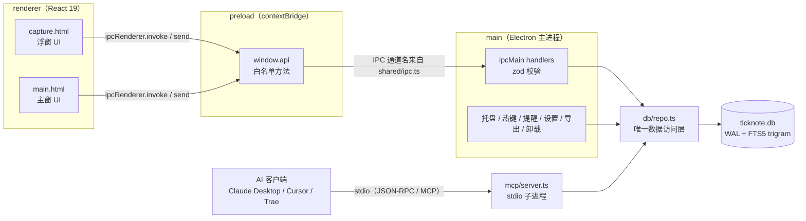

> 中文 | [English](ARCHITECTURE.en.md)

# TickNote 架构说明（0.1.1）

> 面向贡献者的实现级说明。产品/交互的完整规格见仓库根目录的 [DESIGN.md](../DESIGN.md)；MCP 客户端配置见 [MCP.md](MCP.md)。

TickNote 是 Electron + React 19 + SQLite 的单机应用，没有服务端，也没有云同步。它由五个互不越界的小块组成：

| 层           | 位置                   | 职责                                                                                           |
| ------------ | ---------------------- | ---------------------------------------------------------------------------------------------- |
| **main**     | `src/main/`            | Electron 主进程：窗口、托盘、全局热键、提醒调度、设置读写、导出、卸载、IPC handler、数据库访问 |
| **preload**  | `src/preload/index.ts` | `contextBridge` 白名单：只把明确的方法暴露为 `window.api`                                      |
| **renderer** | `src/renderer/`        | React 19 界面，两个入口：`main.html`（主窗）与 `capture.html`（浮窗）                          |
| **shared**   | `src/shared/`          | IPC 通道名（`ipc.ts`）与跨进程 DTO / 类型（`types.ts`）                                        |
| **mcp**      | `src/mcp/server.ts`    | 独立的 stdio MCP server，复用 `main/db/repo.ts`，直连同一个 SQLite 文件                        |

关键约定：

1. `src/main/db/repo.ts` 是**唯一**直接写 SQL 的模块。主进程 IPC 与 MCP server 都调它，禁止在别处拼 SQL。
2. 渲染进程没有 Node 能力，只能通过 `window.api` 访问主进程。
3. 所有跨进程入参在主进程侧用 zod 校验；类型定义集中在 `src/shared/types.ts`。

---

## 1. 总体结构



`main` 与 `mcp` 是**两个独立进程**，不通过 IPC 通信，只通过 SQLite WAL 并发共享同一份数据。

---

## 2. 目录结构

```
ticknote/
├─ src/
│  ├─ main/
│  │  ├─ index.ts              # 入口：单实例、启动编排、热键、提醒调度、导出、卸载
│  │  ├─ windows.ts            # 主窗 / 浮窗创建、定位、显示与窗口加固
│  │  ├─ tray.ts               # 托盘图标、右键菜单、tooltip
│  │  ├─ ipc.ts                # ipcMain handler 注册与 zod 校验
│  │  ├─ settings.ts           # settings.json 读写、safeStorage 加解密、默认值
│  │  ├─ db/
│  │  │  ├─ schema.ts          # DDL + SCHEMA_VERSION（随 bundle 编译，不读运行时文件）
│  │  │  └─ repo.ts            # Repo 接口 + 实现（node:sqlite），唯一数据访问层
│  │  ├─ ai/parse.ts           # OpenAI 兼容 /chat/completions 润色（3 秒超时）
│  │  └─ export/markdown.ts    # 按创建日期导出 notes-YYYY-MM-DD.md
│  ├─ preload/
│  │  └─ index.ts              # contextBridge.exposeInMainWorld('api', ...)
│  ├─ renderer/
│  │  ├─ main.html             # 主窗入口（含 CSP meta）
│  │  ├─ capture.html          # 浮窗入口（含 CSP meta）
│  │  └─ src/
│  │     ├─ main.tsx           # 主窗状态与交互：列表 / 搜索 / 键盘 / 导出
│  │     ├─ capture.tsx        # 浮窗：输入 / 类型切换 / AI 润色 / 自适应高度
│  │     ├─ api.ts             # 渲染层 API 封装；浏览器预览时用 mock
│  │     ├─ utils.ts           # 日期分组、时间格式化、热键转 accelerator
│  │     ├─ hooks.ts           # Draft persistence / errors / dialog focus
│  │     ├─ styles.css         # 两个窗口共用的样式
│  │     └─ components/        # TopBar / ListItem / Drawer / SettingsPanel / ExportDialog / Toast
│  ├─ shared/
│  │  ├─ ipc.ts                # IPC 通道名常量
│  │  ├─ validation.ts         # Item / versioned backup validation
│  │  └─ types.ts              # Item / Settings / 查询与结果 DTO
│  └─ mcp/
│     └─ server.ts             # stdio MCP server（独立进程入口）
├─ resources/
│  └─ mcp/server.js            # esbuild 产物（gitignore，由 npm run build:mcp 生成）
├─ tests/
│  ├─ repo.test.ts             # 库层：分页 / FTS / 提醒 / 清空
│  ├─ export.test.ts           # Markdown 导出格式
│  ├─ reliability.test.ts      # Paging ties / literal search / export / backup restore
│  ├─ settings.test.ts         # Encryption unavailable / write failure / recovery
│  └─ ai-parse.test.ts         # AI 润色请求格式与降级
├─ scripts/
│  ├─ test-mcp.ts              # MCP 端到端测试（stdio 客户端 → server.js）
│  ├─ test-db.ts               # repo 层冒烟脚本（可独立运行）
│  ├─ test-ai.ts               # AI 润色解析冒烟（本地假 HTTP 服务）
│  └─ pack-portable.ps1        # 把 release/win-unpacked 打成便携 zip
├─ build/
│  ├─ icon.png                 # 256px 应用图标
│  └─ installer.nsh            # NSIS 自定义：开始菜单“卸载 TickNote”快捷方式
├─ electron.vite.config.ts     # 三端构建配置（zod 内联进 main bundle）
├─ electron-builder.yml        # NSIS / extraResources / 图标 / 输出目录
├─ vitest.config.mts           # 单元测试配置（tests/**/*.test.ts）
├─ .prettierrc / .prettierignore
├─ tsconfig.json / package.json / .nvmrc
└─ docs/                        # 本目录：架构、MCP、隐私
```

---

## 3. 主进程（`src/main/`）

### 3.1 启动与刷新

`index.ts` 设置应用名/AUMID、数据目录和单实例锁，完成旧库复制迁移后读取设置、打开 repo，注入 IPC 依赖，创建主窗/浮窗/托盘并注册热键。`--autostart` 仅进托盘；开发模式不写登录启动项。主窗 900×640，最小 720×520，关闭收进托盘，托盘退出才结束进程。

启动时补扫错过提醒，此后每 30 秒扫描；每 2 秒读取 `repo.dataVersion()`（`PRAGMA data_version`），发现 MCP 等外部连接写入时广播 `items:changed` 并刷新统计。跨天也触发刷新。退出清理计时器、热键和数据库。窗口恢复焦点时 renderer 另行重查，包含当前搜索。

### 3.2 窗口、托盘、提醒

- `windows.ts`：浮窗宽 620，创建高度 150；渲染后通常 242–298，`capture:resize` 主进程限制 180–330。不透明、置顶、无边框；拖动位置在本次运行内记忆并夹回显示器工作区。失焦隐藏可关闭；×/热键/失焦保留草稿，Esc 明确丢弃。
- `tray.ts`：显示全部未完成待办与待提醒数；不再只统计今天创建的待办。
- 提醒扫描 `remind_at <= now AND reminded_at IS NULL AND status='open'`，先 `markReminded` 再请求系统通知，避免重复；该标记不是实际送达回执。超过 3 条合并，启动补提醒也合并。点击通知进入「提醒」筛选并打开记录，合并通知打开首条。

### 3.3 设置、导出与备份

- `settings.ts` 校验白名单设置，临时文件 flush 后 rename 替换，保留有效旧文件 `.bak`；主文件损坏可恢复。写失败向上抛错，不提交新的内存设置。
- Key 用 `safeStorage` 加密；加密不可用拒绝保存新 Key。旧 `plain:` 值启动时迁移成密文，无法加密则清除。renderer 只获 `aiApiKeySet`，不获明文或密文。
- Markdown 范围：`all | todo | note | done | reminders | today`。主窗选择文件夹，托盘使用上次/默认位置；每次创建独立时间戳+随机后缀目录，日期文件不会覆盖以往导出，提醒包含完整本地日期时间。
- JSON 备份通过系统对话框选择文件；格式 `{format:'ticknote-backup',version:1,exportedAt,items}`。保存全部 `Item` 字段，不含设置、Key、未提交草稿、内部 `ai_run_id`。恢复先完整校验（≤100 MB、≤100000 条），事务插入缺失 id，保留时间且不覆盖已存在记录；失败回滚。每日自动数据库备份尚未实现。
- 卸载只打开 `process.execPath` 同目录的卸载程序；便携版提示直接删除解压目录，卸载保留 userData。

### 3.4 IPC 与 AI

完整通道、入参和返回值见 [DESIGN.md 第 8 节](../DESIGN.md#8-ipc-契约)，精确实现见 `shared/ipc.ts`、`shared/types.ts` 与 `preload/index.ts`。主进程 zod 校验，不信任 renderer。常规增删/状态变化广播刷新；正文编辑与提醒设置由调用方更新界面并刷新托盘。

0.1.1 新增 `backup:export`、`backup:import`（返回 `{path,count} | null`，取消为 null）、`ai:test`（返回 string）；`items:restore-deleted` 服务于列表和抽屉的 5 秒撤销。`items:stats` 返回 `{todayOpenTodos,openTodos,pendingReminders}`；`items:list` 支持 reminders 与复合游标。

`ai:parse`：启用后只在点击时调用，当前输入 ≤2000 字符，3 秒超时，失败返回 null。`ai:test`：已保存配置、固定句「请回复 OK」、10 秒超时，不发送记录。HTTP/model/key 错误向界面反馈。

## 4. Preload（`src/preload/index.ts`）

`contextBridge.exposeInMainWorld('api', api)` 仅暴露具名方法，不暴露 ipcRenderer 或任意通道。订阅 `onCaptureShown`、`onItemsChanged`、`onItemsFocus`、`onOpenSettings` 均返回取消函数。`Api = typeof api` 为 renderer 和浏览器 mock 提供一致类型；备份方法为 `exportBackup/importBackup`，连接测试为 `testAi`。

## 5. 渲染层（`src/renderer/`）

- React 19，主窗与浮窗两个 HTML 入口，共用样式与组件；Electron 缺失 preload 时快速报错，纯浏览器预览使用 mock。
- `hooks.ts` 管理草稿、可读错误和弹层焦点。主窗/浮窗草稿、逐条编辑草稿、分组折叠和抽屉宽度存 localStorage。草稿未入库，不包含在记录备份中。
- 主窗五个筛选：全部/待办/便签/已完成/提醒。提醒筛选含未完成且设提醒的记录（包含已经提醒）。统计使用全部未完成待办。按创建日期分组、可折叠；刷新重载已加载的页数并独立保留选中记录。查询代数防止旧结果覆盖新筛选。
- 搜索 150ms 防抖，覆盖全部记录，不叠加当前筛选；最多 50 条，达到上限提示缩小关键词；变更、外部写入和恢复焦点会重查。
- 浮窗保存成功清空草稿并约 450ms 后隐藏；新编辑/唤起取消旧计时器；提交锁避免连续 Enter 重复。输入法组合期间不提交；Shift+Enter 换行。
- AI 请求与草稿/会话版本绑定，过期结果忽略；撤销同时恢复原文与类型。
- 详情正文失焦或 Ctrl+Enter 保存；关闭、导航、切类型/状态前等待保存，失败保留并可重试。头尾固定，中间滚动；≤780px 使用约 420px 覆盖抽屉，宽窗上限 min(560px,50vw)。自定义提醒需「应用」且未来时间；复制当前草稿有反馈。
- 列表和详情删除统一 5 秒撤销；MCP 硬删除、清空全部不走该撤销。设置/导出对话框包含焦点约束与返回焦点、标签和键盘操作。

## 6. 共享契约（`src/shared/`）

- `ipc.ts`：所有通道常量。
- `types.ts`：Item、ItemCursor、ItemStats、Settings、BackupResult 等；正文上限 `CONTENT_LIMIT=2000`。
- `validation.ts`：备份版本及 Item schema，与删除恢复校验复用。

修改契约需同步 main/preload/renderer/mock，并通过 typecheck。

## 7. 数据库

- `repo.ts` 为唯一数据访问层；`schema.ts` DDL 随包编译。`node:sqlite`，WAL、busy_timeout=3000、synchronous=NORMAL；schema 版本仍为 1，兼容 0.1.0，无应用层“冲突自动重试一次”。
- 时间 UTC 毫秒；列表 `(created_at DESC,id DESC)`，游标 `{createdAt,id}`，边界被删仍续页，数字游标仅兼容。完成、提醒均不改变创建时间分组。
- FTS5 trigram：≥3 字符把双引号转义后按完整短语查询，不剥掉路径、URL、括号；短词走转义 LIKE（含 `%/_/反斜线`）；触发器同步增改删。
- 设置提醒清空 reminded_at；完成写 completed_at、恢复清空。MCP 先验证提醒再一次 INSERT，非法时间不产生半成品。
- Repo 包含 create/list/listRange/search/get/setStatus/updateContent/update/remove/restore/clearAll/importItems/setReminder/dueReminders/markReminded/allForExport/stats/dataVersion/close，以及底层 db。importItems 事务合并，仅主键冲突跳过，其他错误回滚。
- 新迁移应追加分支并递增 SCHEMA_VERSION，不能修改已发布 DDL。

## 8. 安全模型

两个窗口均 `contextIsolation:true`、`nodeIntegration:false`、`sandbox:true`。`hardenWindow` 禁止新窗和导航。CSP 限本地资源，保留开发 HMR 的 ws 与内联样式；AI 网络请求仅由主进程在用户操作时发起。DB/草稿/导出均为本地明文，Key 单独系统加密。IPC 白名单、zod 校验；MCP 删除默认关闭且要求 confirm=true。没有云端、遥测、自动更新或后台联网。

## 9. MCP 进程模型

独立 stdio 进程，仅依赖 SDK 和 repo，不加载窗口模块。esbuild 产物 `resources/mcp/server.js` 用 extraResources 放在 asar 外；客户端以 `ELECTRON_RUN_AS_NODE=1` 调 TickNote.exe，无需另装 Node，App 关闭仍可读写。

数据库解析优先 `TICKNOTE_DB`，其次 `TICKNOTE_DATA`（兼容 QUICKNOTE_DATA），再默认 AppData 路径与旧库回退。删除开关来自数据库同目录 settings.json，修改后重启客户端。默认 5 工具，开启删除为 6；limit≤50、正文≤2000。source=ai 已标记，ai_run_id 已写入，但按批次撤销尚未实现。MCP 不发通知，通知依赖 App 运行。客户端配置见 [MCP.md](MCP.md)。

## 10. 扩展指南

### 10.1 新增一个 IPC

以“把某条记录置顶”（假设通道 `items:pin`）为例：

1. **类型**：在 `src/shared/types.ts` 增加 DTO / 返回类型（若需要）。
2. **通道名**：在 `src/shared/ipc.ts` 的 `IPC` 对象加 `itemsPin: 'items:pin'`。
3. **数据层**：在 `src/main/db/repo.ts` 的 `Repo` 接口与实现里加方法，SQL 只写在这里；必要时在 `tests/repo.test.ts` 补断言。
4. **主进程 handler**：在 `src/main/ipc.ts` 的 `setupIpc(deps)` 里注册 `ipcMain.handle(IPC.itemsPin, ...)`，用 zod 校验入参；写操作后调用 `deps.notifyItemsChanged()`（需要新依赖时向 `IpcDependencies` 补字段，并在 `index.ts` 传参）。
5. **preload**：在 `src/preload/index.ts` 的 `api` 对象加 `pinItem`，返回 `Promise<T>`；事件类（main → renderer）则返回取消订阅函数。
6. **渲染层**：在 `src/renderer/src/api.ts` 的 mock 中补同名方法（保持浏览器预览可用），再在 `main.tsx` / `capture.tsx`（或 `components/` 下的组件）中调用。
7. **文档**：更新本文件的通道表与 [DESIGN.md 第 8 节](../DESIGN.md#8-ipc-契约)。

检查点：`npm run typecheck` 必须通过；新增通道名不得写字符串字面量；不要把 `ipcRenderer` 直接暴露给渲染层。

### 10.2 新增一个 MCP 工具

1. 用 `server.registerTool(name, { title, description, inputSchema, annotations }, handler)`，`inputSchema` 用 zod。
2. 只调 `repo` 的方法，不写 SQL；读操作加 `annotations.readOnlyHint: true`，破坏性操作加 `destructiveHint: true`。
3. 返回值统一走 `ok(serialize(item))` 或 `fail(message)`，序列化字段与现有工具保持一致（`id`、`content`、`kind`、`status`、`created_at`、`updated_at`、`remind_at`、`source`）。
4. 若涉及删除或不可逆操作，默认不注册，由 `settings.json` 的开关控制（参考 `delete_item`）。
5. 更新 [MCP.md](MCP.md) 的工具表，并在 `scripts/test-mcp.ts` 里补一条端到端断言。

### 10.3 修改数据库 schema

1. `src/main/db/schema.ts`：追加 DDL，递增 `SCHEMA_VERSION`。
2. `src/main/db/repo.ts` 的 `migrate()`：为旧版本追加分支（不要改历史分支）。
3. `tests/repo.test.ts`：覆盖迁移前后数据仍在、FTS 仍可命中（vitest，配置见 `vitest.config.mts`）。
4. 在 [CHANGELOG.md](../CHANGELOG.md) 记录。

---

## 11. 已知限制

- 仅 Windows，无云同步、账号、富文本或后台联网。
- MCP 刷新有约 2 秒轮询延迟，不是实时推送。
- GUI 单条删除只有 5 秒撤销，无长期回收站；MCP 删除/清空全部不可通过此操作撤销。
- 每日自动数据库备份、AI 批次撤销尚未实现；当前提供手动 JSON 记录备份。
- 通知受系统设置影响，标记已提醒不等于送达；AI 只润色，不解析日期或自动落库。
- 安装包未签名；安装、自启、通知、输入法与多屏仍需实机人工验证，见 [验证指南](VALIDATION-0.1.1.md)。
