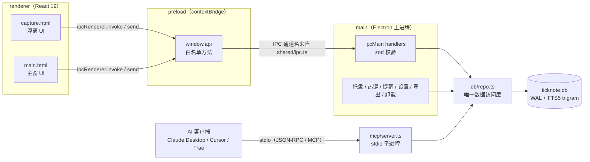
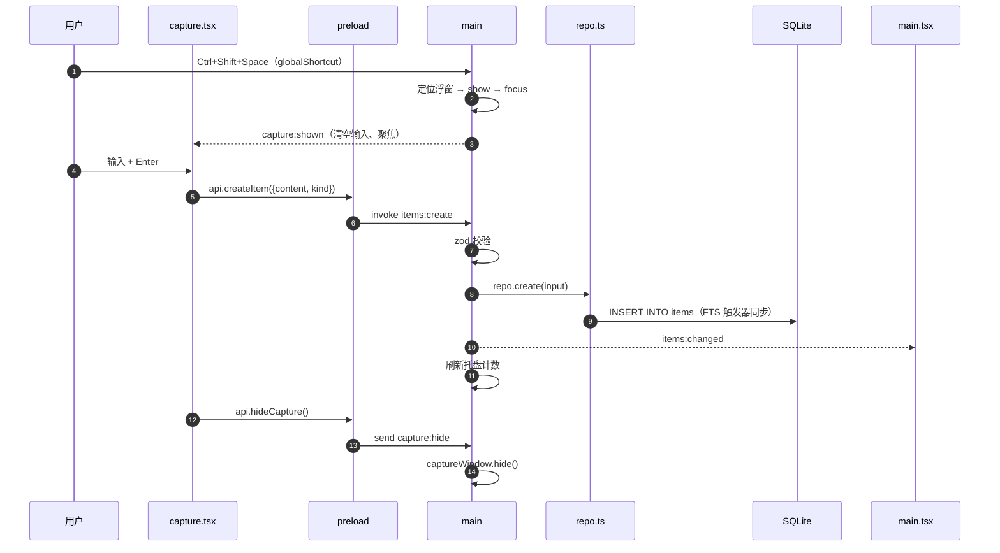

# TickNote 架构说明

> 面向贡献者的实现级说明。产品/交互的完整规格见仓库根目录的 [DESIGN.md](../DESIGN.md)；MCP 客户端配置见 [MCP.md](MCP.md)。

TickNote 是 Electron + React 19 + SQLite 的单机应用，没有服务端，也没有云同步。它由五个互不越界的小块组成：

| 层           | 位置                   | 职责                                                                                           |
| ------------ | ---------------------- | ---------------------------------------------------------------------------------------------- |
| **main**     | `src/main/`            | Electron 主进程：窗口、托盘、全局热键、提醒调度、设置读写、导出、卸载、IPC handler、数据库访问 |
| **preload**  | `src/preload/index.ts` | `contextBridge` 白名单：只把明确的方法暴露为 `window.api`                                      |
| **renderer** | `src/renderer/`        | React 19 界面，两个入口：`main.html`（主窗）与 `capture.html`（浮窗）                          |
| **shared**   | `src/shared/`          | IPC 通道名（`ipc.ts`）与跨进程 DTO / 类型（`types.ts`）                                        |
| **mcp**      | `src/mcp/server.ts`    | 独立的 stdio MCP server，复用 `main/db/repo.ts`，直连同一个 SQLite 文件                        |

关键约定：

1. `src/main/db/repo.ts` 是**唯一**直接写 SQL 的模块。主进程 IPC 与 MCP server 都调它，禁止在别处拼 SQL。
2. 渲染进程没有 Node 能力，只能通过 `window.api` 访问主进程。
3. 所有跨进程入参在主进程侧用 zod 校验；类型定义集中在 `src/shared/types.ts`。

---

## 1. 总体结构



`main` 与 `mcp` 是**两个独立进程**，不通过 IPC 通信，只通过 SQLite WAL 并发共享同一份数据。

---

## 2. 目录结构

```
ticknote/
├─ src/
│  ├─ main/
│  │  ├─ index.ts              # 入口：单实例、启动编排、热键、提醒调度、导出、卸载
│  │  ├─ windows.ts            # 主窗 / 浮窗创建、定位、显示与窗口加固
│  │  ├─ tray.ts               # 托盘图标、右键菜单、tooltip
│  │  ├─ ipc.ts                # ipcMain handler 注册与 zod 校验
│  │  ├─ settings.ts           # settings.json 读写、safeStorage 加解密、默认值
│  │  ├─ db/
│  │  │  ├─ schema.ts          # DDL + SCHEMA_VERSION（随 bundle 编译，不读运行时文件）
│  │  │  └─ repo.ts            # Repo 接口 + 实现（node:sqlite），唯一数据访问层
│  │  ├─ ai/parse.ts           # OpenAI 兼容 /chat/completions 润色（3 秒超时）
│  │  └─ export/markdown.ts    # 按创建日期导出 notes-YYYY-MM-DD.md
│  ├─ preload/
│  │  └─ index.ts              # contextBridge.exposeInMainWorld('api', ...)
│  ├─ renderer/
│  │  ├─ main.html             # 主窗入口（含 CSP meta）
│  │  ├─ capture.html          # 浮窗入口（含 CSP meta）
│  │  └─ src/
│  │     ├─ main.tsx           # 主窗状态与交互：列表 / 搜索 / 键盘 / 导出
│  │     ├─ capture.tsx        # 浮窗：输入 / 类型切换 / AI 润色 / 自适应高度
│  │     ├─ api.ts             # 渲染层 API 封装；浏览器预览时用 mock
│  │     ├─ utils.ts           # 日期分组、时间格式化、热键转 accelerator
│  │     ├─ styles.css         # 两个窗口共用的样式
│  │     └─ components/        # TopBar / ListItem / Drawer / SettingsPanel / ExportDialog / Toast
│  ├─ shared/
│  │  ├─ ipc.ts                # IPC 通道名常量
│  │  └─ types.ts              # Item / Settings / 查询与结果 DTO
│  └─ mcp/
│     └─ server.ts             # stdio MCP server（独立进程入口）
├─ resources/
│  └─ mcp/server.js            # esbuild 产物（gitignore，由 npm run build:mcp 生成）
├─ tests/
│  ├─ repo.test.ts             # 库层：分页 / FTS / 提醒 / 清空
│  ├─ export.test.ts           # Markdown 导出格式
│  └─ ai-parse.test.ts         # AI 润色请求格式与降级
├─ scripts/
│  ├─ test-mcp.ts              # MCP 端到端测试（stdio 客户端 → server.js）
│  ├─ test-db.ts               # repo 层冒烟脚本（可独立运行）
│  ├─ test-ai.ts               # AI 润色解析冒烟（本地假 HTTP 服务）
│  └─ pack-portable.ps1        # 把 release/win-unpacked 打成便携 zip
├─ build/
│  ├─ icon.png                 # 256px 应用图标
│  └─ installer.nsh            # NSIS 自定义：开始菜单“卸载 TickNote”快捷方式
├─ electron.vite.config.ts     # 三端构建配置（zod 内联进 main bundle）
├─ electron-builder.yml        # NSIS / extraResources / 图标 / 输出目录
├─ vitest.config.mts           # 单元测试配置（tests/**/*.test.ts）
├─ .prettierrc / .prettierignore
├─ tsconfig.json / package.json / .nvmrc
└─ docs/                        # 本目录：架构、MCP、隐私
```

---

## 3. 主进程（`src/main/`）

### 3.1 启动顺序

`src/main/index.ts` 是唯一入口，启动流程如下：

1. `app.setName('TickNote')`，并用 `TICKNOTE_DATA`（兼容旧名 `QUICKNOTE_DATA`）覆盖 `userData`，便于测试隔离。
2. `app.setAppUserModelId('com.ticknote.app')`——必须与安装快捷方式的 AUMID 一致，否则 Windows toast 不显示。
3. `requestSingleInstanceLock()`：拿不到锁就退出；第二次启动由 `second-instance` 事件唤起已有主窗。
4. `whenReady` → `bootstrap()`：
   - 移除默认菜单（`Menu.setApplicationMenu(null)`）；
   - `migrateLegacyData(userData)`：做一次幂等迁移（同目录 `quicknote.db` → `ticknote.db`；旧 `%APPDATA%\QuickNote` 目录 → `%APPDATA%\TickNote`）；
   - 读取 `settings.json`，应用 `nativeTheme.themeSource`；
   - 安装版首次启动写入开机启动项（`process.defaultApp !== true` 守卫，避免开发模式把 `electron.exe` 写进启动项）；
   - `openRepo(userData/ticknote.db)` → `setupIpc({repo, ...})`（`ipc.ts`）→ `createMainWindow()` / `createCaptureWindow()`（`windows.ts`）→ `createTray()`（`tray.ts`）→ `registerHotkey()`；
   - 除非带 `--autostart`，否则显示主窗；
   - 先 `scanReminders('missed')` 补发错过的提醒，再启动 30 秒轮询。
5. `before-quit` 调 `markQuitting()`（`windows.ts`）；`will-quit` 清理定时器、注销热键、关闭数据库。
6. `window-all-closed` 故意留空：托盘常驻，窗口全关也不退出。

`index.ts` 只负责编排；窗口、托盘、IPC、设置各自拆到 `windows.ts`、`tray.ts`、`ipc.ts`、`settings.ts`，互相通过显式传入的依赖或导出的 getter 通信，避免循环引用。

### 3.2 窗口

|      | 主窗                                                | 浮窗                                                                   |
| ---- | --------------------------------------------------- | ---------------------------------------------------------------------- |
| 尺寸 | 900×640，最小 720×520，可缩放                       | 620 宽，高度默认 150，主进程限制 120–240                               |
| 外观 | 系统标题栏、背景色随主题                            | `frame:false`、`alwaysOnTop`、`skipTaskbar`、`resizable:false`、带阴影 |
| 关闭 | 拦截 `close` → `hide()`，首次给一次“已收进托盘”气泡 | 渲染层 `×` / `Esc` / 失焦时 `hide()`                                   |
| 位置 | 系统默认                                            | 首次在鼠标所在显示器居中偏上；拖动后本次运行内记住，并夹回 `workArea`  |

浮窗不使用 `transparent:true`（Windows 上透明无边框窗口会让中文输入法候选框错位）。拖拽由渲染层的 `-webkit-app-region: drag` 实现，关闭按钮是 `no-drag`。浮窗内容变化时渲染层调用 `capture:resize` 上报高度，主进程做 clamp。

### 3.3 托盘、热键、提醒

- **托盘**（`src/main/tray.ts`）：图标是内嵌 base64 PNG，不依赖运行时文件；左键单击显示主窗；右键菜单包含「打开浮窗（显示当前热键）/ 打开主窗 / 今天未完成 N 条（禁用）/ 导出 Markdown / 设置 / 退出」。tooltip 显示今日未完成与待提醒数量。
- **热键**：默认 `Control+Shift+Space`，存于 `settings.json`。启动与改键时 `globalShortcut.unregisterAll()` 后重新注册；失败仅置 `hotkeyRegistered=false` 并打日志，设置面板据此显示红字，托盘入口兜底。
- **提醒**：每 30 秒调用 `repo.dueReminders(now)`（`remind_at <= now AND reminded_at IS NULL AND status='open'`），**先** `repo.markReminded()` 落库，**再**弹通知，避免重启重复；同一轮超过 3 条合并为一条；启动时错过的提醒合并成「有 N 条提醒已过期」。点击通知发 `items:focus`，主窗定位并打开抽屉。

### 3.4 设置、导出、卸载

- `settings.json` 位于 `userData/settings.json`，读写集中在 `src/main/settings.ts`。读取时合并默认值，并区分 `aiApiKeySet`（对外只暴露布尔）与内部的 `aiApiKeyEncrypted`；`applySettingsPatch()` 支持传 `onHotkeyChange` 回调，由 IPC 层注入热键重注册。
- 导出：`exportMarkdown(repo.allForExport(scope), userData/export)`，按创建日期分文件；scope 为 `all | todo | note | done | today`。
- 卸载：仅打包版可用。在 `process.execPath` 同目录查找 `Uninstall TickNote.exe`（兼容旧名 `Uninstall QuickNote.exe`），用 `shell.openPath` 打开；开发模式返回 `reason:'dev'`，便携版返回 `reason:'portable'`，由渲染层提示“直接删除解压目录”。

### 3.5 IPC handlers

`setupIpc(deps)` 在 `src/main/ipc.ts` 集中注册；依赖（repo、`notifyItemsChanged`、`refreshTray`、`focusItem`、`exportNow`、`registerHotkey`、`uninstallApp`）通过 `IpcDependencies` 由 `index.ts` 注入，避免循环引用。每个 handler 逐条用 zod 校验入参（字符串长度、uuid 格式、枚举值）。写操作成功后调用 `deps.notifyItemsChanged()`（刷新托盘 + 向主窗发 `items:changed`），渲染层收到后重新拉列表。

完整通道表见 [DESIGN.md 第 8 节](../DESIGN.md#8-ipc-契约)，常用通道：

| 通道                                                   | 方向                    | 入参 → 返回                                                |
| ------------------------------------------------------ | ----------------------- | ---------------------------------------------------------- |
| `items:create`                                         | renderer → main         | `{content, kind}` → `Item`                                 |
| `items:list`                                           | renderer → main         | `{filter, cursor?, limit?}` → `Item[]`（默认 30，最大 50） |
| `items:search`                                         | renderer → main         | `{q, limit?}` → `Item[]`                                   |
| `items:get`                                            | renderer → main         | `{id}` → `Item \| null`                                    |
| `items:update`                                         | renderer → main         | `{id, content}` → `Item \| null`                           |
| `items:set-kind`                                       | renderer → main         | `{id, kind}` → `Item \| null`                              |
| `items:complete` / `items:restore`                     | renderer → main         | `{id}` → `Item \| null`                                    |
| `items:set-reminder`                                   | renderer → main         | `{id, remindAt: number \| null}` → `Item \| null`          |
| `items:delete`                                         | renderer → main         | `{id}` → `boolean`                                         |
| `items:clear-all`                                      | renderer → main         | — → `number`（删除条数）                                   |
| `items:stats`                                          | renderer → main         | — → `{todayOpenTodos, pendingReminders}`                   |
| `export:markdown`                                      | renderer → main         | `{scope}` → `{dir, files, count}`                          |
| `settings:get` / `settings:set`                        | renderer → main         | — / `SettingsPatch` → `Settings`                           |
| `autostart:get` / `autostart:set`                      | renderer → main         | — / `{enabled}` → `AutostartStatus`                        |
| `ai:parse`                                             | renderer → main         | `{content}` → `{content, kind} \| null`                    |
| `app:uninstall`                                        | renderer → main         | — → `UninstallResult`                                      |
| `capture:hide` / `capture:resize` / `window:open-main` | renderer → main（send） | —                                                          |
| `capture:shown`                                        | main → renderer         | 浮窗每次唤起时重置状态并聚焦                               |
| `items:changed`                                        | main → renderer         | 记录增删改后刷新主窗                                       |
| `items:focus`                                          | main → renderer         | `{id}`，点击通知后定位                                     |
| `settings:open`                                        | main → renderer         | 托盘「设置」打开设置面板                                   |

### 3.6 保存流程



注意：**MCP 进程的写入不会触发 `items:changed`**（没有跨进程事件）。主窗只在自身 IPC 写操作、筛选切换或重新挂载时刷新。

---

## 4. Preload（`src/preload/index.ts`）

只做一件事：`contextBridge.exposeInMainWorld('api', api)`。暴露的是显式白名单方法，渲染层拿不到 `ipcRenderer`，也无法指定任意通道名。

- 方法名与通道一一对应：`createItem`、`listItems`、`searchItems`、`getItem`、`completeItem`、`restoreItem`、`updateItem`、`setItemKind`、`deleteItem`、`clearAllItems`、`setReminder`、`exportMarkdown`、`stats`、`getSettings`、`updateSettings`、`setTheme`、`getAutostart`、`setAutostart`、`aiParse`、`uninstallApp`、`hideCapture`、`resizeCapture`、`openMain`。
- 事件订阅返回取消函数：`onCaptureShown`、`onItemsChanged`、`onItemsFocus`、`onOpenSettings`。
- `export type Api = typeof api`，渲染层据此获得完整类型（`src/renderer/src/api.ts` 导入该类型）。

---

## 5. 渲染层（`src/renderer/`）

- React 19 + `react-dom/client`，无路由、无状态库；窗口状态用 `useState` / `useEffect`，持久化只用到 `localStorage`（折叠分组 `ticknote.collapsedDays`）。
- 两个 HTML 入口分别加载 `src/main.tsx`、`src/capture.tsx`，共用 `styles.css`；构建由 `electron.vite.config.ts` 的 `renderer.build.rollupOptions.input` 声明。
- 视图按组件拆分在 `src/renderer/src/components/`：`TopBar`（搜索、`⋯` 菜单、设置入口）、`ListItem`（行卡片）、`Drawer`（详情抽屉）、`SettingsPanel`（设置面板）、`ExportDialog`（导出范围）、`Toast`（轻提示）；日期分组、时间格式化与热键转 accelerator 在 `src/renderer/src/utils.ts`。
- `src/renderer/src/api.ts` 在 `window.api` 存在时直接用 preload API；不存在时（浏览器里静态预览）用内置 mock 数据。若 `navigator.userAgent` 是 Electron 但 `window.api` 缺失，直接抛错提示 preload 未加载。
- 主窗关键交互：
  - 搜索输入 150ms 防抖后调用 `items:search`；清空搜索回落到 `items:list`。
  - 分组按创建日期计算，组头可折叠并写入 `localStorage`。
  - 键盘：`Ctrl+N` 聚焦输入框；`↑`/`↓` 移动选中行，`Enter` 打开抽屉；`Esc` 按「导出弹窗 → 设置 → 搜索 → 抽屉」顺序退出。
  - 抽屉里可编辑正文（失焦保存）、切换类型、设/清提醒、完成/恢复、复制、二次确认删除，并有上一条/下一条。
  - 导出弹窗选择范围（全部 / 当前筛选 / 仅今天）。
- 浮窗关键交互：自适应高度（最高 96px 内部滚动，并把总高度上报主进程）、`Enter` 提交（输入法组合态不提交）、`Esc` 隐藏、`Shift+Enter` 换行、开头 200ms 丢弃空格（防热键尾键漏入）、提示 900ms 后自动隐藏、AI 润色回显与撤销。

---

## 6. 共享契约（`src/shared/`）

| 文件                  | 内容                                                                                                                                                                                                                               |
| --------------------- | ---------------------------------------------------------------------------------------------------------------------------------------------------------------------------------------------------------------------------------- |
| `src/shared/ipc.ts`   | `IPC` 常量对象，所有通道名的唯一来源；main / preload 都从这里引用，禁止写字符串字面量                                                                                                                                              |
| `src/shared/types.ts` | `Item`、`ItemKind`、`ItemStatus`、`ItemSource`、`ListFilter`、`ListQuery`、`CreateItemInput`、`Settings`、`SettingsPatch`、`AutostartStatus`、`AiParseResult`、`ExportScope`、`ExportResult`、`UninstallResult`、`ThemePreference` |

新增或修改 IPC 时，先改这两个文件，再改 main 与 preload，最后改渲染层——这样 TypeScript 会在编译期指出所有需要同步的位置。

---

## 7. 数据库

### 7.1 连接与位置

- 使用 Electron / Node 内置的 `node:sqlite`（`DatabaseSync`），没有第三方依赖，也没有原生模块编译。
- `openRepo()` 执行：`mkdirSync(dirname(dbPath))` → `new DatabaseSync(dbPath)` → `PRAGMA journal_mode = WAL` → `busy_timeout = 3000` → `synchronous = NORMAL` → 迁移。
- 主进程数据库路径：`join(app.getPath('userData'), 'ticknote.db')`，即 `%APPDATA%\TickNote\ticknote.db`（可用 `TICKNOTE_DATA` 改 `userData`）。
- MCP 进程自行解析路径（优先级）：`TICKNOTE_DB` → `TICKNOTE_DATA`（兼容 `QUICKNOTE_DATA`）下的 `ticknote.db`（若只有旧的 `quicknote.db` 则用它）→ `%APPDATA%\TickNote\ticknote.db` → 同目录旧文件名 → `%APPDATA%\QuickNote\quicknote.db` → `~/.ticknote/ticknote.db`。
- 主进程启动时还会做一次幂等迁移，把旧文件名 / 旧目录复制到 `%APPDATA%\TickNote\ticknote.db`。

### 7.2 表结构与索引

`src/main/db/schema.ts` 的 DDL（节选）：

```sql
CREATE TABLE IF NOT EXISTS items (
  id           TEXT PRIMARY KEY,
  content      TEXT NOT NULL,
  kind         TEXT NOT NULL DEFAULT 'note' CHECK (kind IN ('note','todo')),
  status       TEXT NOT NULL DEFAULT 'open' CHECK (status IN ('open','done')),
  remind_at    INTEGER,
  reminded_at  INTEGER,
  created_at   INTEGER NOT NULL,
  updated_at   INTEGER NOT NULL,
  completed_at INTEGER,
  source       TEXT NOT NULL DEFAULT 'human' CHECK (source IN ('human','ai')),
  ai_run_id    TEXT
);

CREATE INDEX idx_items_created ON items(created_at);
CREATE INDEX idx_items_remind  ON items(remind_at) WHERE remind_at IS NOT NULL;
CREATE INDEX idx_items_status  ON items(status, created_at);
```

- 时间统一存 UTC 毫秒，展示时转本地时区；分组只按 `created_at`，`remind_at` 不参与排序。
- `ai_run_id` 由 MCP 的 `create_item` 写入（每次调用一个 UUID），用于标识 AI 写入批次。

### 7.3 全文搜索

```sql
CREATE VIRTUAL TABLE items_fts USING fts5(
  content, content='items', content_rowid='rowid', tokenize='trigram'
);
```

配 `AFTER INSERT / AFTER DELETE / AFTER UPDATE` 三个触发器同步索引。`repo.search()` 的规则：

- 查询串 ≥ 3 字符：走 `items_fts MATCH`；先剔除 FTS 语法字符并作为短语匹配，抛错时回退 `LIKE`。
- 查询串 < 3 字符：直接 `LIKE '%q%'`（数据量小，够用）。

`trigram` 是中文能命中的关键——默认分词器对中文基本无效。

### 7.4 迁移

`migrate()` 读取 `PRAGMA user_version`，小于 `SCHEMA_VERSION`（当前为 `1`）时在一个事务里执行 DDL 并写入新版本号。升级 schema 时**追加**迁移分支、递增 `SCHEMA_VERSION`，不要修改已发布的 DDL。

### 7.5 Repo 接口

`Repo` 接口（`src/main/db/repo.ts`）包含：`create`、`list`、`listRange`、`search`、`get`、`setStatus`、`updateContent`、`update`、`remove`、`clearAll`、`setReminder`、`dueReminders`、`markReminded`、`allForExport`、`stats`、`close`。

其中几条易踩的规则：

- `setReminder` / `update({remindAt})` 必须同时把 `reminded_at` 置 NULL，否则改到未来也不会再提醒。
- `update({status:'done'})` 同步写 `completed_at`；改回 `open` 时清空。
- 完成不改变位置：列表始终按 `created_at` 倒序，已完成项靠样式区分。
- `remove` 是硬删除（无回收站）；`clearAll` 返回删除条数。

---

## 8. 安全模型

| 项                 | 现状                                                                                                                     |
| ------------------ | ------------------------------------------------------------------------------------------------------------------------ |
| `contextIsolation` | **开启**，渲染层无法访问 Node / Electron 内部对象                                                                        |
| `nodeIntegration`  | **关闭**                                                                                                                 |
| `sandbox`          | **开启**（两个窗口都设置 `sandbox: true`；preload 只用 `contextBridge` + `ipcRenderer`，无需 Node）                      |
| 渲染层来源         | 只加载本地文件（`loadFile`）或开发期 `ELECTRON_RENDERER_URL`；`hardenWindow()` 拒绝新窗、阻止 `will-navigate`            |
| CSP                | 两个 HTML 入口都带最小化 CSP meta（见下）                                                                                |
| IPC 入参           | 主进程侧 zod 校验（长度、uuid、枚举），渲染层不被信任                                                                    |
| 渲染层能力         | 仅 `window.api` 白名单方法；通道名来自 `shared/ipc.ts`，无法自定义                                                       |
| AI Key             | `safeStorage.encryptString()` 后 base64 存入 `settings.json` 的 `aiApiKeyEncrypted`；渲染层只能读到 `aiApiKeySet` 布尔值 |
| AI Key 降级        | `safeStorage.isEncryptionAvailable()` 为 false 时写入 `plain:<base64>` 前缀（明确标注未加密），避免假装已加密            |
| 数据库             | 仅在主进程 / MCP 进程打开，WAL + `busy_timeout` 支持并发                                                                 |
| 单实例             | `requestSingleInstanceLock`，避免两个实例同时写库                                                                        |
| 卸载               | 只打开安装目录内的卸载程序，路径来自 `process.execPath` 同目录，不接受渲染层传入                                         |
| MCP 删除           | `delete_item` 默认不注册；开启后也要求 `confirm: true` 硬删除                                                            |
| 菜单               | `Menu.setApplicationMenu(null)`，无默认菜单与开发者快捷键入口                                                            |

`src/main/windows.ts` 的 `hardenWindow()` 对两个窗口统一做两件事：

```ts
win.webContents.setWindowOpenHandler(() => ({ action: 'deny' }));
win.webContents.on('will-navigate', (event) => event.preventDefault());
```

CSP 写在 `src/renderer/main.html` 与 `src/renderer/capture.html` 的 `<meta http-equiv="Content-Security-Policy">` 中：

```
default-src 'self'; script-src 'self' 'unsafe-inline'; style-src 'self' 'unsafe-inline';
img-src 'self' data:; font-src 'self'; connect-src 'self' ws:;
object-src 'none'; base-uri 'none'; form-action 'none'
```

- `connect-src 'self' ws:` 留给开发期 Vite HMR；生产构建不会发起任何网络请求（AI 调用在主进程发起，不受渲染层 CSP 限制）。
- `'unsafe-inline'` 是为 Vite 注入与组件内联样式保留的折中；后续如需收紧，可评估去掉并在构建阶段处理内联样式。

---

## 9. MCP 进程模型

- `src/mcp/server.ts` 只用 `@modelcontextprotocol/sdk` 的 `McpServer` + `StdioServerTransport`，组合 `repo.ts`。**不加载**任何窗口 / 托盘 / Electron UI 模块，因此可以脱离 App 运行。
- 构建：`npm run build:mcp` 用 esbuild 打成单文件 CJS `resources/mcp/server.js`（SDK 与 repo 一并内联）；该文件在 `.gitignore` 中，不入库。
- 打包：`electron-builder.yml` 的 `extraResources` 把 `resources/mcp` 复制到安装目录 `resources\mcp`，**不压进 asar**，保证可被外部进程执行。
- 启动：AI 客户端用安装目录里的 `TickNote.exe`，通过环境变量 `ELECTRON_RUN_AS_NODE=1` 以 Node 模式执行 `server.js`；用户无需另装 Node。
- 删除开关：进程启动时读取**数据库同目录**的 `settings.json`，只有 `mcpDeleteEnabled === true` 才注册 `delete_item`。MCP 进程由各客户端各自拉起，所以改开关后需重启客户端。
- 并发：与主进程相同的 WAL + `busy_timeout=3000`；单次调用只写一条记录，冲突时依赖 SQLite 的忙等待重试。
- 限制：`limit ≤ 50`，`content ≤ 2000` 字符，`update_item` 的 ISO 时间非法时返回错误文本而不是抛异常。

详见 [MCP.md](MCP.md)。

---

## 10. 扩展指南

### 10.1 新增一个 IPC

以“把某条记录置顶”（假设通道 `items:pin`）为例：

1. **类型**：在 `src/shared/types.ts` 增加 DTO / 返回类型（若需要）。
2. **通道名**：在 `src/shared/ipc.ts` 的 `IPC` 对象加 `itemsPin: 'items:pin'`。
3. **数据层**：在 `src/main/db/repo.ts` 的 `Repo` 接口与实现里加方法，SQL 只写在这里；必要时在 `tests/repo.test.ts` 补断言。
4. **主进程 handler**：在 `src/main/ipc.ts` 的 `setupIpc(deps)` 里注册 `ipcMain.handle(IPC.itemsPin, ...)`，用 zod 校验入参；写操作后调用 `deps.notifyItemsChanged()`（需要新依赖时向 `IpcDependencies` 补字段，并在 `index.ts` 传参）。
5. **preload**：在 `src/preload/index.ts` 的 `api` 对象加 `pinItem`，返回 `Promise<T>`；事件类（main → renderer）则返回取消订阅函数。
6. **渲染层**：在 `src/renderer/src/api.ts` 的 mock 中补同名方法（保持浏览器预览可用），再在 `main.tsx` / `capture.tsx`（或 `components/` 下的组件）中调用。
7. **文档**：更新本文件的通道表与 [DESIGN.md 第 8 节](../DESIGN.md#8-ipc-契约)。

检查点：`npm run typecheck` 必须通过；新增通道名不得写字符串字面量；不要把 `ipcRenderer` 直接暴露给渲染层。

### 10.2 新增一个 MCP 工具

1. 用 `server.registerTool(name, { title, description, inputSchema, annotations }, handler)`，`inputSchema` 用 zod。
2. 只调 `repo` 的方法，不写 SQL；读操作加 `annotations.readOnlyHint: true`，破坏性操作加 `destructiveHint: true`。
3. 返回值统一走 `ok(serialize(item))` 或 `fail(message)`，序列化字段与现有工具保持一致（`id`、`content`、`kind`、`status`、`created_at`、`updated_at`、`remind_at`、`source`）。
4. 若涉及删除或不可逆操作，默认不注册，由 `settings.json` 的开关控制（参考 `delete_item`）。
5. 更新 [MCP.md](MCP.md) 的工具表，并在 `scripts/test-mcp.ts` 里补一条端到端断言。

### 10.3 修改数据库 schema

1. `src/main/db/schema.ts`：追加 DDL，递增 `SCHEMA_VERSION`。
2. `src/main/db/repo.ts` 的 `migrate()`：为旧版本追加分支（不要改历史分支）。
3. `tests/repo.test.ts`：覆盖迁移前后数据仍在、FTS 仍可命中（vitest，配置见 `vitest.config.mts`）。
4. 在 [CHANGELOG.md](../CHANGELOG.md) 记录。

---

## 11. 已知限制（有意为之）

- **仅 Windows**：托盘、toast、NSIS 安装包都是 Windows 实现，没有 macOS / Linux 分支。
- **无实时跨进程通知**：MCP 写入后主窗不会自动刷新（见 3.6）。
- **无回收站**：删除不可撤销，只有二次确认。
- **无云同步 / 账号 / 富文本**：数据库单文件即唯一数据源，靠导出 Markdown 兜底。
- **AI 只做润色**：不解析日期、不自动落库，失败保留原文。
- **未签名**：构建产物未做代码签名，SmartScreen 会提示未知发布者。
